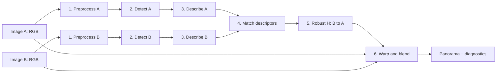
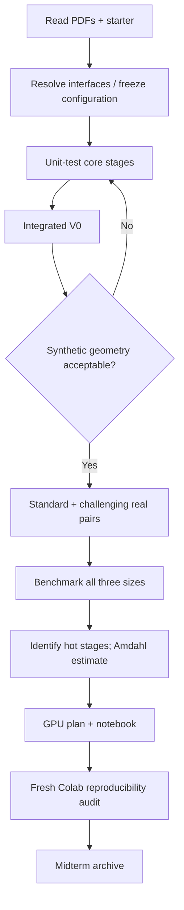

# CSC14120 — MIDTERM ENGINEERING SPECIFICATION
## Two-Image Panorama Stitching: Sequential Baseline (V0) and Evidence-Based CUDA Proposal

> **Intended use:** This document is the technical **source of truth for planning and implementing the midterm**, not a claim that the midterm has already been completed. It can be reviewed by the team, versioned in Git, and provided to a coding agent as a contract before any source code is written.
>
> **Authority tags:** **[REQ]** denotes a requirement from the supplied course PDFs; **[DESIGN]** is a recommended engineering choice, not prescribed by the instructor; **[TBD]** means that a real starter notebook, team input, fixture, dataset, or experiment must resolve the detail. Proposed numerical thresholds are **not official grading thresholds**.
>
> **No invented evidence:** This specification contains **no actual runtimes, GPU speedups, synthetic errors, or panorama results**. Those must be produced by the subsequently implemented V0 and preserved in notebook output cells.

**Primary assignment**: `CSC14120_2026_Final Project_MidTerm.pdf`, pp. 1–3, §§1–4.  
**Supporting context**: `CSC14120_2026_Final Project.pdf`, pp. 1–9, especially §§1–4 and §6.  
**Additional technical sources**: peer-reviewed literature, official OpenCV/NVIDIA documentation, MIT *Foundations of Computer Vision*, and Szeliski's textbook, listed in §19.

**Math rendering:** This Markdown uses GitHub-flavored math notation: `$...$` for inline formulas and standalone `$$` lines for display formulas. Use a Markdown preview with LaTeX/KaTeX/MathJax support (for example, GitHub or a current VS Code Markdown preview). A plain-text editor will show the LaTeX source rather than typeset equations.

---

## Contents

1. [Decision summary and authority](#1-decision-summary-and-authority)
2. [Midterm requirements and evidence traceability](#2-midterm-requirements-and-evidence-traceability)
3. [Problem, coordinate systems, and geometric validity](#3-problem-coordinate-systems-and-geometric-validity)
4. [Architecture and pipeline contracts](#4-architecture-and-pipeline-contracts)
5. [Algorithm selection and alternatives](#5-algorithm-selection-and-alternatives)
6. [Proposed configuration and determinism](#6-proposed-configuration-and-determinism)
7. [Detailed stage specifications and mathematical foundations](#7-detailed-stage-specifications-and-mathematical-foundations)
8. [Numerical reliability and failure handling](#8-numerical-reliability-and-failure-handling)
9. [Logical data model and interfaces](#9-logical-data-model-and-interfaces)
10. [Dataset acquisition and preparation](#10-dataset-acquisition-and-preparation)
11. [Repository structure and build architecture](#11-repository-structure-and-build-architecture)
12. [Verification strategy and synthetic benchmark](#12-verification-strategy-and-synthetic-benchmark)
13. [Sequential performance measurement and Amdahl analysis](#13-sequential-performance-measurement-and-amdahl-analysis)
14. [GPU migration proposal: V1 mapping and later optimizations](#14-gpu-migration-proposal-v1-mapping-and-later-optimizations)
15. [Midterm Colab notebook specification](#15-midterm-colab-notebook-specification)
16. [Implementation tasks, ordering, and ownership](#16-implementation-tasks-ordering-and-ownership)
17. [Risk register, ADRs, and change control](#17-risk-register-adrs-and-change-control)
18. [Definition of Done and submission audit](#18-definition-of-done-and-submission-audit)
19. [Source review, references, and corrections to initial design](#19-source-review-references-and-corrections-to-initial-design)
20. [Agent handoff contract](#20-agent-handoff-contract)

---

# 1. Decision summary and authority

## 1.1 Objective

Given **two partially overlapping RGB photographs** of the same scene, compute a single panorama by preprocessing each image, detecting local features, describing and matching features, estimating a **projective transformation from image B to image A**, and warping/blending both photographs onto a common canvas. The two-image limit is intentional.

The **midterm-specific goal** is a *working, measured, fully sequential C/C++ reference (V0)* and a credible GPU plan derived from its timings. The complete V0 is a **future implementation deliverable**, not part of this documentation-only writing task. A CUDA implementation of V1 and later optimized variants is **not required at midterm**. [MID §§1, 3.4–3.7]

## 1.2 Mandatory midterm outputs (when coding is complete)

1. `GroupXX_Midterm.zip` submitted by one team member; it contains `GroupXX_Midterm.ipynb` with **saved outputs**, and a buildable `src/` directory. [MID §2]
2. Names, student IDs, and a work allocation plan covering stages and future versions. [MID §3.1]
3. Explanation of the six-stage panorama pipeline, with chosen methods, key parameters, output-quality rationale, and suitability for later GPU parallelism. [MID §§3.2–3.3]
4. A complete **single-threaded C/C++ V0**, compatible with the **provided starter notebook interfaces**; no OpenMP, `std::thread`, or manually written SIMD. [MID §3.4]
5. Synthetic-image homography error against known ground truth, panoramas from at least **one standard pair per site**, and per-stage runtime at all **three resolutions**. [MID §3.5]
6. Identification of bottlenecks, scaling trends, the observed time fraction `p` of stages slated for acceleration, and the corresponding Amdahl limit. [MID §3.5]
7. The team's registered dataset: **at least three sites**, one standard pair per site, and one challenging pair, together with a notebook-accessible link to both raw and prepared data. [MID §§2, 3.6; FIN §1.2]
8. A justified GPU migration plan: which stages, work mapping by thread/warp/block, two or three candidate optimizations, and risks. [MID §3.7]
9. The notebook must compile from the **submitted `src/` files**, run top-to-bottom on a fresh Colab environment after the sources are made available, and derive its reported numbers from captured outputs. [MID §4]

**Administrative details:** Due by **23:59 at the end of week 7**; midterm accounts for **10% of the overall project grade**. The calendar date and submission portal must be verified on the course website. [MID p. 1]

## 1.3 Intentionally deferred beyond midterm

- Implementing or benchmarking V1 basic CUDA or V2/V3+ optimization kernels.
- Final-version GPU profiling/screenshots, multi-version speedup charts, final presentation slides, final video, and final-defense preparation.
- Multi-image stitching, automatic exposure correction, cylindrical projection, GUI, or learned descriptors unless a documented scope change is approved.

The overall final-project brief expects V0, V1 (every stage on GPU), and **at least two later optimized versions**; this expectation informs our interfaces but **does not move their implementation into the midterm**. [FIN §3]

## 1.4 Requirement precedence and uncertainty

1. **Midterm PDF** decides *what must be delivered now*.
2. **Final Project PDF** clarifies the mathematical pipeline, image requirements, CLI, timing, and project-long rules.
3. The **actual starter notebook and starter source** determine the exact build commands, type definitions, function signatures, and synthetic fixture interface. They have **not been provided for this document**, so anything dependent on them is [TBD].
4. External references justify scientific and engineering choices, but cannot override course requirements.
5. Existing implementations, familiar libraries, or coding-agent assumptions must not silently redefine the contract.

**Canonical-design policy:** Treat this revised English specification as the proposed primary engineering design. Where it differs from the earlier Vietnamese draft, this English version takes precedence **after team review**, provided neither conflicts with the instructor PDFs or starter.

---

# 2. Midterm requirements and evidence traceability

| ID | Course source | Requirement | Planned evidence | Completion gate |
|---|---|---|---|---|
| M-01 | MID §3.1 | Team identity and allocation through final | Notebook team/ownership table | All assignments explicit |
| M-02 | MID §3.2 | Explain the stitching problem | Pipeline figure and narrative | Six stages and data dependencies correct |
| M-03 | MID §3.3 | Select a method per stage | Algorithm/parameter/rationale table | Quality and GPU rationale provided |
| M-04 | MID §3.4 | Sequential reference pipeline | Source and executable V0 | Complete, no forbidden parallelism |
| M-05 | MID §3.4 | Starter interface compliance | Signature/build check | Interface verified against starter |
| M-06 | MID §3.5 | Homography correctness on synthetic pair | `H_gt`, `H_est`, numerical error | Measured and honestly interpreted |
| M-07 | MID §3.5 | One panorama per registered site | Image gallery | At least three genuine standard results |
| M-08 | MID §3.5 | Per-stage timing at 3 image sizes | Machine-produced timing tables | Small, medium, and large covered |
| M-09 | MID §3.5 | Identify expensive stages and scaling | Rankings and charts | Claims follow measured data |
| M-10 | MID §3.5 | Amdahl fraction and limit | Consistent `p` definition and calculation | Reproducible from same timing rows |
| M-11 | MID §3.6; FIN §1.2 | Capture and prepare unique dataset | Site log, manifest, prepared pairs | 3 sites + 3 standard + 1 challenging |
| M-12 | FIN §1.2 | Three resolutions, 16:9 | Dataset validation report | 1280×720; 1920×1080; 3840×2160 |
| M-13 | MID §3.7 | Planned GPU stages/mapping | V1 mapping table | Thread/warp/block work is stated |
| M-14 | MID §3.7 | Later ideas and risks | Optimization hypotheses/risk register | 2–3 ideas and associated hazards |
| M-15 | MID §§2,4 | Reproducible notebook with outputs | Fresh-Colab Run All test | Builds from submitted `src/` only |
| M-16 | MID §2 | ZIP and author/source comments | Archive manifest + source headers | Correct names and provenance |
| M-17 | MID §4; FIN §6 | Report only observed evidence | Notebook-generated text/tables | Every experimental number is traceable |

**Interpretation:** This document defines the implementation/evidence **plan** for M-01–M-17. It does not mark runtime, geometric, visual, or Colab requirements as satisfied before those artifacts exist.

---

# 3. Problem, coordinate systems, and geometric validity

## 3.1 Input/output contract

- `A` = left/reference photograph, RGB, `W_A × H_A` pixels.
- `B` = right/moving photograph, RGB, `W_B × H_B` pixels.
- `H_BA ∈ ℝ^{3×3}` maps **points of B into A's coordinate system**.
- `Panorama` = RGB canvas containing A and geometrically transformed B, with explicit valid-coverage masks and overlap blending.
- Pixel centers have integer coordinates: origin top left, +x right, +y down; `0 ≤ x ≤ W−1`, `0 ≤ y ≤ H−1`.
- Keep the A/B ordering unchanged for the entire pipeline; don't silently swap it on poor results.

**Homogeneous projective model:**

$$
\lambda\begin{bmatrix}x_A\\y_A\\1\end{bmatrix}
=H_{BA}\begin{bmatrix}x_B\\y_B\\1\end{bmatrix},\quad
H_{BA}=\begin{bmatrix}h_{11}&h_{12}&h_{13}\\h_{21}&h_{22}&h_{23}\\h_{31}&h_{32}&h_{33}\end{bmatrix}.
$$

Let `d = h31*xB + h32*yB + h33`. For finite, nonzero `d`:

$$
x_A=\frac{h_{11}x_B+h_{12}y_B+h_{13}}{d},\qquad
 y_A=\frac{h_{21}x_B+h_{22}y_B+h_{23}}{d}.
$$

A homography has **eight independent degrees of freedom** because multiplying all nine entries by the same nonzero scalar leaves the geometric mapping unchanged. Comparing unnormalized coefficients element by element is **not a meaningful accuracy test**. See [R4], [R5].

## 3.2 When a single homography is appropriate

A single planar projectivity is a reasonable model for (i) a predominantly planar scene, or (ii) a camera rotating about approximately the same optical center while capturing a static scene. Translating the camera induces depth-dependent parallax; a single homography generally cannot perfectly align objects at different depths. Large moving foreground objects and strong rolling-shutter effects are further failure modes.

**Capture instructions from the assignment:** stand in one position and **rotate, do not walk**; aim for **30–50% overlap**. [FIN §1.2]

## 3.3 Forward and inverse map distinction

**Feature geometry** uses `H_BA : B → A` because candidate matches pair a B point with the corresponding A point.

**Resampling** asks which source location contributed to one output pixel; therefore, for a canvas translation `T` and output pixel `q_canvas`, the correct B sampling coordinate is

$$
p_B=\pi\!\left(H_{BA}^{-1}\,T^{-1}\,\tilde q_{canvas}\right).
$$

This distinction is a frequent source of panoramas being displaced in the wrong direction. An identity/known-translation test must validate it **before** attempting natural images.

## 3.4 Registration and panorama quality are separate tests

Correctness cannot be inferred from a visually attractive-looking blend alone:

- **Geometry:** ground-truth point-transfer error, inlier reprojection error, orientation, expected displacement.
- **Appearance:** doubled edges, ghosting, seam visibility, interpolation artifacts, color imbalance.
- **Validity:** all buffers initialized, coverage masks correct, canvas bounded, failure state explicit.
- **Repeatability:** same inputs/configuration/seed produce equivalent results.

All four are relevant; only synthetic geometry directly gives known ground truth.

---

# 4. Architecture and pipeline contracts

## 4.1 Six stages and execution dependencies



Stages **1–3** are independent for A and B; stages **4–6** depend on both images. In **V0**, processing remains sequential even though its dataflow exposes future GPU opportunities. [FIN §2.1]

## 4.2 Stage-level contract table

| Stage | Input | Output | Units / invariants | Expected work pattern |
|---|---|---|---|---|
| 1 Preprocess | RGB pixels | grayscale and smoothed grayscale | same W,H; finite floats | per pixel; separable stencil |
| 2 Detect | smoothed intensity | ordered feature points | response finite; no invalid border points | gradients/stencils; NMS; top-K |
| 3 Describe | image + keypoints | descriptors with matching indices | one valid binary descriptor per retained point | per keypoint, local sampling |
| 4 Match | descriptor sets A,B | filtered correspondences | A index / B index in range | all-pairs comparison |
| 5 Homography | coordinates of correspondences | `H_BA`, inlier set, fit status | finite, nondegenerate geometry | sample, solve, score, refit |
| 6 Warp/blend | RGB A,B and `H_BA` | RGB panorama, coverage masks | valid extent and pixel values | independent destination pixels |

## 4.3 Top-level architecture principles

1. Use **one immutable algorithm/configuration contract** across V0 and future GPU variants (required for fair later comparisons). [FIN §3]
2. Preserve a single C/C++ source tree (`src/`) as the source of truth; the notebook orchestrates build and experiments but **does not replace submitted sources with cell-generated copies**. [MID §4]
3. Separate **calculation** from file loading/saving, JSON/CSV serialization, visualization, and plotting.
4. Treat each algorithm stage as an independently testable unit with a status/result boundary.
5. Carry deterministic seeds and explicit coordinates through module interfaces; avoid mutable hidden global state.
6. Keep GPU-specific code outside all V0 computational functions; `main.cu` may remain a starter-defined build/dispatch wrapper, but V0 itself must run on the CPU in one thread.

---

# 5. Algorithm selection and alternatives

## 5.1 Proposed baseline, not instructor-mandated

**[DESIGN: ADR-001, provisional]** Choose a mathematically transparent feature pipeline that can later be mapped to predictable GPU work:

| # | Proposed V0 method | Reason for visual/geometric quality | GPU relevance | Main limitation |
|---|---|---|---|---|
| 1 | RGB→grayscale + separable Gaussian smoothing | attenuates sensor noise | pixel kernels, 1D convolution | oversmoothing removes corners |
| 2 | Harris detector + 3×3 NMS + top-K | interpretable corners and deterministic selection | 2D stencil + selection/compaction | no intrinsic scale invariance |
| 3 | **Oriented BRIEF-inspired**, 256-bit | compact local comparisons, limited rotation robustness | keypoint-wise operations | not the complete ORB algorithm |
| 4 | brute-force Hamming, nearest/second, ratio filtering + reciprocal NN | removes many ambiguous binary matches | bitwise XOR/popcount, tiling | all-pairs O(K_A K_B) |
| 5 | four-correspondence RANSAC + **normalized homogeneous DLT**, final inlier refit | rejects spurious matches | independent hypotheses and reductions | numerical degeneracy, random sampling |
| 6 | common bounding canvas, inverse bilinear warp, explicit-mask feather blend | continuous sampling and softer overlap transitions | destination-pixel gather | may leave ghosting/brightness seams |

**Important terminology:** The proposed detector is **Harris**, not ORB's FAST detector; the descriptor borrows the **orientation steering of BRIEF** from ORB, but may use a different pattern, sampling procedure and no image pyramid. Call it **"Harris + oriented-BRIEF-style descriptor"**, not "full ORB". OpenCV's ORB tutorial verifies these distinctions. [R2]

## 5.2 Why these choices instead of a turnkey stitcher?

The assignment requires a measurable, explainable six-stage pipeline, ultimately mapping stages to CUDA. A complete black-box stitching library hides both algorithmic work and meaningful per-stage timings. The recommended design therefore **implements the actual chosen stages**, while **permitting image I/O, standard container types, and a documented numerical solver where the starter rules allow them**.

**[TBD] External-library policy:** The PDFs permit cited/adapted open-source code, but do not provide the complete starter interface or specify a complete library whitelist. Do not assume an OpenCV geometry/stitching call is either permitted or forbidden without checking starter constraints. If a helper library is used, state precisely what work it performs; don't misrepresent library work as custom V0 algorithm code.

## 5.3 Explicit alternatives and change triggers

| Problem observed on actual images | Alternative to evaluate | Decision requirement |
|---|---|---|
| Too few robust corners | Shi–Tomasi / FAST; spatially distributed selection | Compare feature counts and geometric inlier support |
| Significant scale variation | image pyramid or SIFT-like pipeline | Estimate CPU/GPU complexity change and accuracy trade-off |
| Descriptor mismatches under rotation | more disciplined ORB-like orientation/pattern | Do not label partial implementation "ORB" |
| Ratio + reciprocal check too restrictive | retune ratio or use alternative filtering | Re-run all V0 tests after freezing settings |
| Visible seam despite good geometry | exposure normalization or multi-band blending | Separate a future enhancement from minimum midterm scope |

Algorithms and parameters must be chosen **before the official benchmark**; if the baseline method changes, regenerate affected evidence rather than mixing configurations.

---

# 6. Proposed configuration and determinism

## 6.1 Baseline candidates (subject to tests and starter validation)

| Parameter | Initial value | Meaning / caution |
|---|---:|---|
| `gray_coefficients` | 0.299, 0.587, 0.114 | conventional 8-bit RGB luma approximation; not linear-light luminance |
| `gaussian_size` | 5 × 5 | two identical 1D passes |
| `gaussian_sigma_px` | 1.2 | standard deviation of smoothing |
| `border_policy` | clamp-to-edge | define uniformly for gradients, convolution, sampling |
| `harris_sobel` | 3 × 3 | fix normalization of Sobel gradients once |
| `harris_second_moment_window` | 5 × 5 Gaussian, σ = 1.2 | smooth products, **not raw gradients** |
| `harris_kappa` | 0.04 | Harris response constant |
| `harris_nms` | 3 × 3 | deterministic tie-breaking |
| `harris_threshold_relative` | 0.01 of max positive response | internal candidate, not assignment criterion |
| `max_keypoints` | 1,500 per image | after border exclusion |
| `descriptor_length` | 256 bits | eight 32-bit words |
| `descriptor_radius` | 15 px | offsets selected within disk of radius 15 |
| `descriptor_pattern_seed` | 2026 | record generated offsets/hash permanently |
| `match_ratio_max` | 0.80 | threshold **candidate**, not a universal optimal setting |
| `mutual_check` | true | nearest A↔B agreement |
| `ransac_seed` | 2026 | seed resets deterministically per pair/run |
| `ransac_max_trials` | 2,000 | number of sampled hypotheses; invalid samples handled explicitly |
| `ransac_reprojection_thresh_medium_px` | 3.0 | threshold at reference width 1,920 px |
| `ransac_min_inliers` | 8 | **internal safety proposal**; ≥4 is mathematical minimum |
| `warping_interpolation` | bilinear | pixel-center convention |
| `blending` | valid-mask feather | use distance to source border with ε > 0 |
| `benchmark_repetitions` | at least 5 | after warm-up; not a performance result |

**Color clarification:** Coefficients 0.299/0.587/0.114 apply to conventional gamma-encoded RGB luma approximations for many image-processing pipelines; they should **not** be described as physically correct linear-light luminance without gamma decoding. The choice is defensible for feature detection if applied consistently.

## 6.2 Resolution-dependent policy

Required prepared image sizes from the final brief:

| Size | Width × height | Use |
|---|---:|---|
| Small | 1280 × 720 | quick development/debugging |
| Medium | 1920 × 1080 | primary performance comparison |
| Large | 3840 × 2160 | image-size scaling |

**[DESIGN]** To preserve a consistent geometric tolerance across resized copies, define

$$
\tau_{\mathrm{RANSAC}}(W)=3.0\;\frac{W}{1920}\ \text{pixels},
$$

where `W` is the prepared width of A. This is a **predeclared scale policy**, not a requirement or a result. The fixed 15-pixel descriptor radius and other pixel-space parameters **do not automatically become scale-invariant**; assess their impact with the same scenes at all three sizes, and choose a coherent cross-resolution policy before measuring.

## 6.3 Reproducibility contract

- Dataset revision and raw/prepared-file checksums are immutable for a benchmark series.
- Keypoint sorting and nearest-neighbor ties use a documented total order.
- The BRIEF pattern is generated **once** and shared across all runs and versions. The seed alone is insufficient for cross-compiler reproducibility unless the exact PRNG/distribution and conversion to coordinates are specified; saving a fixed, versioned pattern table is preferable.
- The RANSAC sample sequence is deterministic per `pair_id`, size, and declared seed, not affected by an earlier test's RNG state.
- CPU floating-point numerics are compared with declared tolerances, rather than demanding bit-identical results across different toolchains.
- Any parameter change increments the configuration revision and invalidates dependent benchmark comparisons.

---
# 7. Detailed stage specifications and mathematical foundations

Each stage specifies its **mathematics**, **sequential implementation behavior**, **GPU implications**, and **observable tests**. The actual API signatures must later be reconciled with the starter notebook.

## 7.1 Stage 1 — Grayscale conversion and Gaussian smoothing

### Mathematical foundations

Given an 8-bit RGB pixel, form the approximate luma

$$
I(x,y)=0.299R(x,y)+0.587G(x,y)+0.114B(x,y).
$$

Represent grayscale as `float32` or another explicitly chosen floating-point type for subsequent derivatives. Define the continuous Gaussian

$$
G_\sigma(x,y)=\frac{1}{2\pi\sigma^2}
\exp\left(-\frac{x^2+y^2}{2\sigma^2}\right),
$$

and obtain its **discrete, finite, normalized** filter weights. A separable Gaussian satisfies

$$
G_\sigma(x,y)=g_\sigma(x)g_\sigma(y),\qquad
I_s = (g_\sigma^{(y)} * (g_\sigma^{(x)} * I)).
$$

For a `k×k` kernel, two 1D passes use on the order of `2k` taps per pixel instead of `k²` taps; the actual CPU speedup still depends on cache, allocation, and implementation details.

### Sequential behavior

1. Convert A and B independently, in a fixed order.
2. Compute Gaussian weights once, normalize their sum to 1, and apply horizontal then vertical convolution.
3. Apply the declared clamp-to-edge boundary rule; every output pixel is written exactly once.
4. Preserve original RGB input for the final warping/blending stage.
5. Include convolution buffers in stage ownership (memory lifetime and elapsed time); exclude image decode from stage timing.

### Tests and failure conditions

- A constant image stays constant after smoothing (within floating-point tolerance).
- Grayscale reproduces known one-pixel RGB cases and has the same dimensions as input.
- Tiny images don't trigger out-of-bounds reads, including width/height smaller than kernel size.
- Alpha-containing or grayscale input is either explicitly converted by image I/O or rejected; the core input contract requires RGB.

**GPU mapping (proposal):** one thread per grayscale output pixel; one thread per output pixel for each Gaussian pass, with 2D grids and later optional halo tiling. [FIN §2.2]

## 7.2 Stage 2 — Harris keypoint detection

### Mathematical foundations

Corners exhibit strong intensity variation under **small displacements in more than one direction**. For local derivatives `I_x` and `I_y`, compute the smoothed second-moment matrix

$$
M(x,y)=\begin{bmatrix}
S_{xx}&S_{xy}\\S_{xy}&S_{yy}
\end{bmatrix},\quad
S_{xx}=G*I_x^2,\quad
S_{xy}=G*(I_xI_y),\quad
S_{yy}=G*I_y^2.
$$

Its eigenvalues describe the strength of intensity variation along two principal directions. Harris avoids explicit eigenvalue calculation using

$$
R(x,y)=\det M-\kappa(\operatorname{tr}M)^2
=S_{xx}S_{yy}-S_{xy}^2-\kappa(S_{xx}+S_{yy})^2.
$$

High positive `R` is characteristic of many corners; flat regions generally yield low magnitude; strong single-direction edges often yield a negative response. **Harris is a detector**, not a rotation- or scale-invariant descriptor. [R1]

### Sequential behavior

1. Compute horizontal and vertical gradients using fixed 3×3 Sobel masks; document normalization (e.g. raw integer weights or a fixed 1/8 scale).
2. Compute `Ix²`, `Iy²`, and `IxIy`, and smooth each product with the **second-moment Gaussian**, not the original grayscale blur by accident.
3. Evaluate the Harris response at each pixel; reject nonfinite values.
4. Determine `Rmax = max(R)` over valid candidates; if `Rmax ≤ 0`, return zero keypoints.
5. Retain only pixels with `R > 0` and `R ≥ 0.01*Rmax` (candidate rule).
6. Apply local non-maximum suppression over a 3×3 window. If two responses are equal, pick the feature with lexicographically smaller `(y,x)`; do not accidentally keep a plateau of duplicate features.
7. Exclude keypoints too near the image boundary to allow a complete rotated descriptor patch and bilinear footprint. With a radius-15 circular pattern, use at least `radius + 1` pixels, with any stricter starter policy documented.
8. Sort by descending response, then increasing `(y,x)`, and select at most `K` retained points. If `K=1,500`, actual counts can be smaller.

### Precision and design caveats

- Absolute Harris thresholds are sensitive to image intensity scale and gradient normalization; relative thresholding reduces, but does not eliminate, this dependence.
- Plain global top-K can cluster features in one textured region. If homography estimation becomes unstable, evaluate spatial grid quotas **as an explicit algorithm change**, not an undocumented optimization.
- Harris detects corners near scale changes, but without a scale pyramid the descriptors use a fixed pixel neighborhood; do not claim complete scale invariance.

### Tests and complexity

- Uniform image: no corners.
- Checkerboard or synthetic intersection: positive corners in expected neighborhoods.
- End-to-end keypoint invariants: unique coordinates, finite response, complete descriptor margin, and `count ≤ K`.
- Deterministic output ordering across repeated V0 runs.

Gradients and response maps are essentially `O(WH)` for fixed window sizes; a global sort of all candidates is approximately `O(N log N)`, while bounded top-K selection may reduce overhead. The exact hot stage must be **measured**.

**GPU mapping (proposal):** pixel kernels for derivatives and response, a local NMS kernel, compaction through a prefix scan or another suitable GPU primitive, then selection. The variable-length candidate list is the main scheduling challenge. [FIN §2.2]

## 7.3 Stage 3 — Harris-keypoint oriented-BRIEF-style descriptor

### Mathematical foundations

A BRIEF descriptor stores outcomes of pairwise intensity comparisons in a patch surrounding one keypoint. For a fixed list of `n=256` two-dimensional offset pairs `(p_i,q_i)` and a keypoint position $\mathbf{x}=(x,y)^T$, one bit is

$$
b_i=\mathbf{1}\!\left[I_s(\mathbf{x}+\mathbf{p}_i)<I_s(\mathbf{x}+\mathbf{q}_i)\right],\qquad i=0,\ldots,255.
$$

For a more rotation-tolerant variant, compute the patch's **intensity centroid** using moments over a disk `Ω` centered at the keypoint:

$$
m_{pq}=\sum_{(u,v)\in\Omega} u^p v^q I_s(x+u,y+v),\qquad
\theta=\operatorname{atan2}(m_{01},m_{10}).
$$

For oriented BRIEF, replace each offset $\mathbf{p}_i$ and $\mathbf{q}_i$ by $R_\theta\mathbf{p}_i$ and $R_\theta\mathbf{q}_i$ before sampling, where

$$
R_\theta=\begin{bmatrix}\cos\theta&-\sin\theta\\\sin\theta&\cos\theta\end{bmatrix}.
$$

Then evaluate intensities at the rotated positions, using one defined sampling/interpolation policy. ORB popularized orientation estimation via intensity centroid and **steered BRIEF**; its complete detector/descriptor system also incorporates FAST and a scale pyramid. Our combination should be described accurately as **Harris + oriented-BRIEF-style**, not full ORB. [R2, R3]

### Sequential behavior

1. Generate and **freeze** a 256-test pattern of point pairs within a radius-15 **disk**, not a square whose rotated points may exceed the permitted radius. Record the actual offset table or its checksum.
2. For each valid Harris keypoint, calculate moments over the defined disk on the smoothed image, using local coordinates relative to the feature center.
3. If both first-order moments are near zero (ambiguous orientation), use a **documented deterministic fallback**, such as `θ=0`, and flag the degeneracy in diagnostics if it matters.
4. Rotate offsets about the keypoint. Use the declared float interpolation rule for each sample. Ensure bilinear neighboring pixels are valid; apply the precomputed border margin.
5. Pack bits `0..255` into eight `uint32` words; bit `i` occupies `(i % 32)` of word `(i / 32)` with a stated bit order.
6. Keep keypoint/descriptor indices aligned by producing one accepted descriptor for each emitted retained keypoint, or by performing an explicit synchronized compaction.

### Tests and limitations

- Identical patch + keypoint + pattern gives identical bits across repeated executions.
- Explicit fixture with known intensities exercises bit ordering and bilinear coordinates.
- Hamming distance between a descriptor and itself is exactly zero.
- Every selected sample lies within the image and all returned descriptor bits are initialized.
- Test rotated synthetic patches to characterize robustness, **not to assert perfect invariance**.

Orientation steering reduces some in-plane rotation sensitivity; without image pyramids or scale-normalized patches it is still vulnerable to scale changes, blur, severe perspective change, and repeated texture.

**GPU mapping (proposal):** one CUDA thread per keypoint is the simplest V1 starting point; more granular per-warp work may be investigated only if measurements justify it.

## 7.4 Stage 4 — Binary descriptor matching

### Mathematical foundations

The **Hamming distance** between two binary descriptors is the number of differing bits:

$$
d_H(a,b)=\operatorname{popcount}(a\oplus b)
=\sum_{j=0}^{7}\operatorname{popcount}(a_j\oplus b_j).
$$

For each descriptor in A, find the lowest and second-lowest Hamming distances to descriptors in B (`d1`, `d2`). A commonly used ambiguity filter is a Lowe-style ratio test:

$$
\frac{d_1}{d_2}<r,\qquad r=0.80,\quad d_2>0.
$$

This was originally motivated in the context of real-valued SIFT descriptor matching; for **binary Hamming distances** it is a *heuristic that must be validated empirically*, not a theoretical guarantee. OpenCV's matcher documentation identifies Hamming as the appropriate distance for BRIEF/ORB-style binary vectors and describes reciprocal cross-checking. [R6]

A reciprocal check keeps `(i,j)` only if `j` is A's nearest neighbor in B **and** `i` is B's nearest neighbor in A, under deterministic tie rules.

### Sequential behavior

1. Reject early if either descriptor list is empty. For an A→B ratio test, at least two B candidates are needed.
2. For every A descriptor, scan all B descriptors and retain nearest and second-nearest **distinct candidate indices**, with deterministic sorting `(distance, candidate_index)`.
3. Separately compute nearest B→A correspondences for reciprocal validation.
4. Apply the ratio and reciprocal conditions. With `d2=0`, reject as ambiguous; do not divide by zero. If `d1=d2`, the ratio fails for any `r<1`.
5. Produce sorted `(index_A,index_B,distance,ratio)` records. Keep the numeric distance/ratio for diagnostics rather than re-matching in RANSAC.

### Expected computational cost

Given up to `K_A` and `K_B` descriptors, brute-force comparisons are `K_A*K_B`, each consuming eight XOR/popcount pairs for a 256-bit descriptor. For 1,500 descriptors on each side, **2,250,000 candidate pairs** are considered. That count is a **complexity illustration, not an observed runtime**. GPU all-pairs tiling can reduce redundant memory access. [FIN §2.2]

### Tests

- XOR and popcount on hand-constructed 256-bit vectors.
- Equal distances and duplicate patterns must not cause undefined tie handling.
- Reciprocal check yields no repeated B index if the nearest-neighbor policy is one-to-one.
- No candidate index is out of range and matching does not mutate descriptors.
- Too few candidates produce a controlled status, not a crash.

**GPU mapping (proposal):** initially one thread per A descriptor, scanning all B descriptors; a 2D A×B distance kernel with segmented top-2 reduction is an alternative requiring more scratch space. Optimize after profiling, not by assumption.

## 7.5 Stage 5 — Robust B→A homography estimation

### 7.5.1 Homogeneous DLT derivation

Let each match supply `(x,y)` in B and `(u,v)` in A, and let the row-major homography vector be

$$
h=(h_{11},h_{12},h_{13},h_{21},h_{22},h_{23},h_{31},h_{32},h_{33})^T.
$$

Projective equality yields **two linear equations per correspondence**:

$$
\begin{bmatrix}
-x&-y&-1&0&0&0&ux&uy&u\\
0&0&0&-x&-y&-1&vx&vy&v
\end{bmatrix}h=0.
$$

Stacking `N` pairs forms `A h = 0`, where `A` is `2N×9`. Four nondegenerate point pairs supply eight independent constraints for a homography's eight degrees of freedom. The standard **homogeneous DLT** solution is a unit-length right singular vector of `A` associated with the smallest singular value (equivalently an eigenvector of `AᵀA` with smallest eigenvalue, with caution about condition-number squaring). [R4]

**Correction relative to a simplified 8×8 solver:** fixing `h33=1` and solving eight unknowns can be a usable gauge-dependent *nonhomogeneous linear solve* in ordinary cases, but it is **not the fully general homogeneous DLT/SVD formulation**, and it can fail when the true `h33` is close to zero. This document therefore specifies **normalized homogeneous DLT as the reference algorithm**. An alternative numerical implementation is permitted only through a documented ADR and tests demonstrating equivalent accuracy under the supported input domain.

### 7.5.2 Hartley-style point normalization

Before fitting, independently normalize point coordinates in both images:

- Translate each point set so its centroid is at the origin.
- Uniformly scale so the **mean Euclidean distance** from the origin is `√2`.
- Let `T_B` normalize points in B and `T_A` normalize those in A.
- Fit $\widehat{H}$ on the normalized point pairs, then **denormalize in the correct direction**:

$$
H_{BA}=T_A^{-1}\widehat H T_B.
$$

After denormalization, fix the arbitrary scale using a documented rule (e.g. divide by Frobenius norm and select a consistent sign), **not by unconditionally dividing by `h33`**. Normalization improves conditioning but does not repair degenerate correspondences. It is standard numerical practice for DLT-like geometric estimation. [R4, R5]

### 7.5.3 RANSAC model fitting

RANSAC repeatedly samples four **distinct** correspondences, estimates a candidate homography, and counts pairs agreeing with it. Use **forward B→A reprojection error**:

$$
e_i=\left\|\pi(H_{BA}\tilde p_{B,i})-p_{A,i}\right\|_2,
\qquad i\text{ is an inlier if }e_i<\tau_{\mathrm{px}}.
$$

Define a deterministic candidate score:

1. **Maximize** number of inliers.
2. On equal count, **minimize** total or mean reprojection error over inliers.
3. On remaining tie, prefer the earlier sampled iteration (or another documented total order).

After selecting a model, refit with **all of its inliers** using normalized homogeneous DLT, recompute the inlier mask and error statistics, and validate again. An optional local refinement may be added only as a separately recorded change.

**RANSAC probability model:** if a sampled correspondence has approximate inlier probability `w` and sampling is idealized as independent,

$$
P(\text{at least one all-inlier 4-sample in }N\text{ trials})
=1-(1-w^4)^N.
$$

Consequently, the common approximate trial budget for confidence `c` is

$$
N\ \ge\ \frac{\log(1-c)}{\log(1-w^4)}
\quad \text{for }0<w<1.
$$

This approximation depends on an estimated `w`; it **does not guarantee** a correct homography, even with an all-inlier sample, due to feature noise, geometric degeneracy, or a wrong model. Sampling four distinct indices without replacement is required in the implementation even though the formula uses a convenient independence approximation. [R4, R7]

### 7.5.4 Degeneracy and model validation

Reject or skip samples with:

- Fewer than four distinct correspondences or repeated coordinate pairs.
- Three or more source or destination sample points effectively collinear (numerical area/tolerance test), or insufficient configuration rank.
- Near-zero spread under point normalization, singular or ill-conditioned DLT, nonfinite entries.
- A near-singular candidate matrix or projective denominators too close to zero at evaluated points.

For the final model, require at least the internally chosen inlier threshold, an invertible finite matrix, and a **bounded warp canvas**. A homography that fits a few correspondences but explodes the output region is **not a valid stitching result**.

### Tests and diagnostics

- Known identity, translation, rotation/affine, and mild perspective homographies.
- Ground-truth point transfer with noise-free and noisy synthetic correspondences.
- Injected outliers: RANSAC should reject many, with outcomes measured rather than guaranteed.
- Degenerate all-collinear inputs: return an informative failure.
- Diagnostic fields: `matches`, `valid_trials`, `inlier_count`, `inlier_fraction`, `mean_inlier_px`, `median_inlier_px`, `H_BA`, `status`.

**GPU mapping (proposal):** one warp or block per hypothesis is a defensible future mapping; counting inliers is a reduction. Keep the V0 random-sampling contract and threshold unchanged so geometry differences are explainable.

## 7.6 Stage 6 — Output canvas, inverse warping, and feather blending

### 7.6.1 Compute a finite canvas

A's reference-space bounds come from its four pixel-center corners; project the four corresponding corners of B using `H_BA`. If the projected polygon is valid and finite, set

$$
x_{\min}=\left\lfloor\min_x(\text{8 corners})\right\rfloor,
\quad x_{\max}=\left\lceil\max_x(\text{8 corners})\right\rceil
$$

and similarly for `y`. Under the **inclusive pixel-center policy** proposed here,

$$
W_{canvas}=x_{\max}-x_{\min}+1,\quad
H_{canvas}=y_{\max}-y_{\min}+1.
$$

Define the translation from A coordinates to canvas coordinates as

$$
T=\begin{bmatrix}
1&0&-x_{\min}\\0&1&-y_{\min}\\0&0&1
\end{bmatrix}.
$$

**Projective singularity check:** The denominator `h31*x+h32*y+h33` varies linearly over B's rectangular source domain. It must not cross zero inside that rectangle. Check the **sign and margin at all four corners** (as well as finite projections); a sign change implies a horizon/infinity crossing, even if individual projected corners look finite. Reject unsafe transforms.

Before allocating, use checked integer arithmetic for `width*height*channels`, establish a maximum pixel count/memory budget, and reject extreme canvas expansion rather than risking allocation overflow.

### 7.6.2 Inverse warping and interpolation

For every output pixel center `q`, obtain source A and B coordinates:

$$
p_A=\pi(T^{-1}\tilde q),\qquad
p_B=\pi(H_{BA}^{-1}T^{-1}\tilde q).
$$

A can be sampled at its translated integer coordinates. B uses **bilinear interpolation**; for continuous source coordinates `(x,y)` with `x0=floor(x)`, `y0=floor(y)`, `α=x−x0` and `β=y−y0`,

$$
\begin{aligned}
C(x,y)=&(1-\alpha)(1-\beta)C_{00}
+\alpha(1-\beta)C_{10}\\
&+(1-\alpha)\beta C_{01}+\alpha\beta C_{11}.
\end{aligned}
$$

A source point is considered valid if its continuous center lies in `[0,W−1]×[0,H−1]`; handle any needed right/bottom bilinear neighbors with an explicitly defined edge clamp. Pixels outside that continuous range are invalid. **Do not treat an RGB value of `(0,0,0)` as absence of data**.

### 7.6.3 Explicit-coverage feather blending

Maintain Boolean validity masks `mask_A`, `mask_B`. For a pixel covered by just one image, copy that valid image; for neither, write a declared background value and flag invalid coverage.

For a pixel covered by both, define positive weights from the distance to the nearest **source-image border**; one simple candidate for pixel `(x,y)` in source image width `W`, height `H` is

$$
d(x,y)=\min(x,\,y,\,W-1-x,\,H-1-y),\qquad
w(x,y)=\epsilon+\max(0,d(x,y)),
$$

with `ε>0`. Compute weights using the source locations `p_A` and `p_B`, then blend

$$
C_{out}=\frac{w_A C_A+w_B C_B}{w_A+w_B}.
$$

The source-border-distance policy creates a smooth transition without requiring a global distance transform; it is **one proposed feathering implementation**, not the only possible method. Feathering cannot eliminate ghosting caused by parallax, moving people, or incorrect `H`.

### Tests and safety properties

- Identity homography on identical images: dimensions, masks, and output are correct.
- Known translation: image B moves in the **intended B→A direction** and the resulting canvas is neither mirrored nor clipped.
- Black pixels remain valid if supplied by the image.
- No uninitialized output pixels; no NaN/Inf sample coordinates or allocations.
- Extreme perspective/singular transforms are rejected with a clear error.
- Compare overlap blending with a hand-checkable two-color fixture.

**GPU mapping (proposal):** one thread per destination pixel; B sampling is a gather operation. Texture-memory interpolation and coalescing are **later performance ideas**, not midterm obligations. [FIN §2.2]

---

# 8. Numerical reliability and failure handling

## 8.1 Shared failure policy

A failed image pair **must not silently produce a fake identity panorama**. Return a structured status, informative diagnostics, and a nonzero process exit where appropriate. The midterm's challenging pair can be analyzed as a genuine failure case if needed.

| Status (logical) | Trigger | Required behavior |
|---|---|---|
| `INVALID_INPUT` | unsupported channels, empty/bad dimensions | reject with file/context metadata |
| `INSUFFICIENT_FEATURES` | detector/descriptors provide too few points | return counts and no homography |
| `INSUFFICIENT_MATCHES` | less than 4 valid correspondence pairs | stop before geometric solve |
| `DEGENERATE_GEOMETRY` | collinear/ill-conditioned fits | reject candidate(s) and ultimately fail if none valid |
| `HOMOGRAPHY_NOT_FOUND` | RANSAC has no valid consensus | record stats, no misleading panorama |
| `UNSAFE_CANVAS` | singularity/horizon/memory overflow | reject safely, no huge allocation |
| `IO_FAILURE` | read/write errors | identify failing path and operation |
| `INTERNAL_ERROR` | invariant violation | surface reproducible test information |

## 8.2 Numerical design rules

- Use `double` precision in the CPU homography solver and matrix inversion; use `float` for image buffers if memory/performance favor it.
- Use **scale-aware** degeneracy tolerances after coordinate normalization, not arbitrary checks in raw 4K pixels.
- Prefer stable SVD or a trusted small-matrix numerical routine for DLT; computing eigenvectors of `AᵀA` squares condition numbers and is a trade-off to document.
- Reject nonfinite intermediate results (`NaN`, `Inf`), not just nonfinite final pixels.
- Normalize matrices by scale-invariant rules and compare *point mappings*, not arbitrary homography coefficient gauges.
- Memory ownership must be explicit across stage failures; no stage may leave partially written output treated as success.
- If a source is adapted, record exact upstream origin, license, revision, and edits in its file header and notebook.

## 8.3 Quality gates before any performance tuning

1. Geometry fixture tests pass.
2. Standard-site panoramas are acceptably aligned by visual inspection, and failures are reported.
3. Every stage's output satisfies its invariants and is repeatable.
4. Full V0 runs cleanly in a fresh Colab build from submitted sources.
5. Only then should benchmark data be used to justify the GPU plan.

---

# 9. Logical data model and interfaces

> **[TBD] The precise starter function names and type signatures are unknown.** Types below are *logical contracts*, not drop-in `common.h`/`versions.h` declarations. Do **not** implement names from this document until the real starter interfaces have been inspected.

## 9.1 Data entities

| Conceptual type | Essential fields | Invariants |
|---|---|---|
| `RGBImage` | width, height, channel count, pitch, byte storage | 3 channels; validated storage and ownership |
| `GrayImage` | width, height, scalar storage | aligned source coordinates; finite outputs |
| `Feature` | x, y, score, angle | finite; border-supported; stable index |
| `BinaryDescriptor256` | eight 32-bit words | all bits initialized, documented word/bit order |
| `FeatureSet` | features, matching descriptors | 1-to-1 association of points and descriptors |
| `Match` | indexA, indexB, hamming, ratio | no invalid/reused accepted indices |
| `HomographyResult` | `H_BA`, inlier mask, stats, status | mask indexing matches correspondence ordering |
| `PanoramaResult` | RGB buffer, dimensions, coverage, status | bounded dimensions; every output pixel initialized |
| `PipelineConfig` | method parameters, seeds, revision | frozen during a comparison |
| `StageTimings` | six stage durations, total, overhead | well-defined unit: milliseconds |

## 9.2 Conceptual module boundaries

| Boundary | Responsible behavior | Excluded behavior |
|---|---|---|
| `preprocess(image, config)` | gray + separable blur | disk loading and matching |
| `detect(gray, config)` | gradient, Harris, NMS, top-K | descriptor construction |
| `describe(gray, features, pattern)` | orientations + packed BRIEF | geometric filtering |
| `match(descA, descB, config)` | Hamming, ratio, reciprocal | homography estimation |
| `estimate_h(matches, featuresA, featuresB, config)` | DLT, RANSAC, refit | warping and color operations |
| `warp_blend(A, B, H, config)` | canvas, resampling, masks, blend | feature matching |
| `run_v0(A, B, config)` | **sequential** orchestration + stage timers | independently duplicated algorithms |

`main.cu` / starter dispatch remains a separate adapter. If the starter signatures differ, adapt these conceptual boundaries **around the real interface**, not vice versa.

## 9.3 Command line and output compatibility

The Final Project defines the long-term command form (the midterm only needs `version 0`): [FIN §4.1]

```text
./stitch <left_image> <right_image> <output_image> --version <0|1|2|...> [--runs N]
```

- The image order must be A (left/reference), then B (right/moving).
- `--version 0` selects sequential V0; unimplemented versions must fail explicitly, not silently fall back.
- `--runs N` should default to **5** once implemented, while warm-up and timing details remain consistent with §13.
- Image load/save costs are excluded from the final project's measured pipeline end-to-end computation time; still record full program wall time separately if useful and **do not confuse the two**.

**[DESIGN] Machine-readable results:** emit one stable JSON/CSV summary per run/pair containing `pair_id`, `resolution`, `version`, `config_revision`, `seed`, `feature_counts`, `match_count`, `inlier_count`, `H_BA`, `stage_ms`, `total_compute_ms`, and `status`. Record CPU/GPU model and compiler separately in the notebook. Avoid parsing fragile human-formatted progress logs for numerical evidence.

## 9.4 Semantics of a source-level contract

- Public V0 entry points accept the exact starter-defined inputs and emit exact required outputs.
- Internal functions report failure without producing malformed buffers.
- No dynamic dispatch to accelerator code from V0.
- `v0_*` orchestration calls the **same six chosen mathematical methods** that GPU versions will later reproduce.
- An implementation change that affects match order, RANSAC sampling, or numerical solver is recorded as a **behavioral change**, not just a performance optimization.

---

# 10. Dataset acquisition and preparation

## 10.1 Minimum required collection

**[REQ; FIN §1.2, MID §3.6]** The team captures its **own photographs at sites that other teams do not use**, consistent with the course's registration process. The minimum set is:

- At least **3 different sites**, with variety (for example indoor, outdoor, third chosen by the team).
- **3 standard pairs**: one two-image pair per site.
- **1 challenging pair**: low texture, repetitive patterns, dynamic objects, low light, or another documented difficulty.
- Every pair cropped to **16:9**, with **three prepared copies** per image at small, medium, and large dimensions.

With exactly four pairs, there are **12 prepared pairs / 24 prepared RGB image files** (excluding raw images and synthetic fixtures). This is a required-artifact count derived from the assignment, **not a performance claim**.

## 10.2 Capture protocol

1. Record/confirm site registrations before photography; save `site_id`, location label, scene type, and team ownership without exposing unnecessary private location data in public artifacts.
2. Hold position and rotate the camera; avoid walking sideways. Target 30–50% visual overlap.
3. Prefer consistent focal length, landscape orientation, focus, exposure, and white balance across a pair.
4. Use source photographs with enough genuine detail to support 3840×2160 crops. If a raw source needs upscaling, **disclose it**; resizing it does not restore lost detail.
5. Preserve untouched originals and a separate documented prepared set.
6. Record why the challenging pair is challenging; **do not silently replace it just because V0 fails**.

## 10.3 Recommended directory layout

```text
dataset/
├── manifest.csv
├── raw/
│   ├── site_01_standard/{A_original.jpg,B_original.jpg}
│   ├── site_02_standard/{A_original.jpg,B_original.jpg}
│   ├── site_03_standard/{A_original.jpg,B_original.jpg}
│   └── site_XX_challenging/{A_original.jpg,B_original.jpg}
├── prepared/
│   ├── small/                   # 1280 × 720, same pair IDs
│   ├── medium/                  # 1920 × 1080, same pair IDs
│   └── large/                   # 3840 × 2160, same pair IDs
└── synthetic/                   # official starter fixture(s), if distributed
```

**Suggested manifest fields:** `pair_id`, `site_id`, `difficulty`, `registered_site`, `raw_A_path`, `raw_B_path`, `small_A/B`, `medium_A/B`, `large_A/B`, `crop_policy`, `resample_policy`, `notes`, `data_revision`, `sha256`.

## 10.4 Preparation and validation procedure

- Decode and apply EXIF orientation consistently *before* cropping.
- Choose crops independently for A and B while retaining actual overlap and **preserving scene geometry**; crop to exact 16:9 aspect ratio.
- Resize using one declared method and library to the exact required width/height, at all sizes.
- Verify file presence, RGB channel count, dimensions, nonzero content, and pair membership.
- Preserve a link in the notebook to a team-accessible archive containing both `raw/` and `prepared/` (for example a Google Drive ZIP, as permitted by MID §2).
- Record hashes; if crops change, mark a new dataset revision and re-run all affected benchmarks.

## 10.5 Synthetic geometry fixture

The midterm **requires** homography error on a synthetic image pair against ground truth. **Neither supplied PDF specifies the actual starter-generated pair, matrix, or scoring formula.** The team must inspect the starter notebook to determine these exact details.

A development-only fallback fixture (not a substitute for the assigned fixture): create a synthetic view pair from a known transform, keep the forward B→A ground-truth matrix, and generate expected point correspondences. Test separately identity, translation, moderate rotation, mild perspective, and deliberate outliers. Never label a self-created fixture as an official supplied test.

---

# 11. Repository structure and build architecture

## 11.1 Respect the starter skeleton

The midterm PDF illustrates these source files within the submitted `src/` directory: `common.h`, `cuda_utils.cuh`, `versions.h`, `main.cu`, `stb_impl.cpp`, plus `v0_<name>.cpp` and any further C/C++ headers/source required to build. [MID §2]

**Starter-first rule:** do not redefine an existing `common.h` data structure, `versions.h` callable signature, build flags, or `main.cu` dispatch convention until the actual starter has been read. The filenames shown in the assignment are **authoritative examples of packaging**, not evidence that the missing starter's API matches a guessed declaration.

## 11.2 Proposed repository layout

```text
CSC14120-panorama/
├── docs/
│   ├── MIDTERM_SPEC_EN.md          # this document; authoritative design
│   ├── DECISIONS.md                # architecture decision records (ADRs)
│   └── TEST_PLAN.md                # optional split of §12
├── src/                            # exact source-of-truth directory for submission
│   ├── common.h                    # match actual starter
│   ├── versions.h                  # match actual starter
│   ├── cuda_utils.cuh              # keep if starter build needs it
│   ├── main.cu                     # starter CLI/version entry point
│   ├── stb_impl.cpp                # image library implementation and license
│   ├── v0_stitch.cpp               # sequential orchestration
│   ├── preprocess.h
│   ├── preprocess.cpp
│   ├── harris.h
│   ├── harris.cpp
│   ├── oriented_brief.h
│   ├── oriented_brief.cpp
│   ├── matching.h
│   ├── matching.cpp
│   ├── homography.h
│   ├── homography.cpp
│   ├── warp_blend.h
│   ├── warp_blend.cpp
│   ├── timing.h
│   └── timing.cpp
├── tests/                          # local development, optional in submission
│   ├── unit/
│   ├── geometry/
│   └── fixtures/
├── scripts/                        # dataset preparation/validation
├── dataset/                        # external linked data, not duplicated into midterm ZIP
├── outputs/                        # local generated evidence, never substituted for saved cells
├── GroupXX_Midterm.ipynb           # eventual submitted notebook
├── README.md                       # recommended internal instructions
└── .gitignore
```

**These module splits are suggested, not mandated.** If the starter supports a simpler `v0_stitch.cpp` plus a handful of headers, prefer the simpler compliant design over extensive boilerplate. The midterm ZIP must contain **all and only needed build sources** in its `src/` subtree; do not assume notebooks may compile from developer-only paths.

## 11.3 Responsibility and source integrity

| File group | Owns | Should not own |
|---|---|---|
| `main.cu`, starter adapter | CLI, image loading/saving adapter, dispatch | duplicate image algorithms |
| `v0_stitch.cpp` | sequential stage invocation/timing/error paths | `std::thread`, OpenMP, GPU computation |
| `preprocess.*` | luma, Gaussian passes | matching, file I/O |
| `harris.*` | Sobel, moments, response, NMS, top-K | binary matching |
| `oriented_brief.*` | moments/orientation, fixed pattern and bits | geometry fitting |
| `matching.*` | Hamming matching and filtering | resampling |
| `homography.*` | normalization, DLT, RANSAC, refit | panorama image blending |
| `warp_blend.*` | finite canvas, inverse warp, masks, blending | feature selection |
| `timing.*` | monotonic CPU stage timing and counters | altering algorithm configuration |
| Notebook | compile and run **submitted `src/`**, charts, explanations | hidden alternative source tree |

The midterm requires that **every created or modified source file** contain a header comment listing **authors and any external source adapted**. Keep upstream attribution/licenses intact. [MID §2; FIN §6]

## 11.4 Build and reproducibility guidelines

- Compiler command, C++ standard, CUDA toolkit version (if `main.cu` is compiled with `nvcc`), include paths, dependency versions, and binary name are **[TBD starter]**.
- Compile a CPU-only V0 computation; ensure standard library or image decode libraries do not introduce hidden multithreaded work inside **measured V0 stages**.
- No OpenMP, `std::thread`, or hand-written CPU SIMD in V0. Auto-vectorization from an ordinary compiler is not expressly prohibited by MID §3.4; disclose compiler flags, and do not claim an artificially "scalar" performance baseline unless compiler settings actually enforce it.
- Favor bounded stack objects for small matrices and managed dynamic buffers for images. Avoid global writable arrays that complicate independent pairs/runs.
- Freeze dependencies; a fully fresh Colab build is the acceptance test, not a local compiler success alone.

---

# 12. Verification strategy and synthetic benchmark

## 12.1 Verification layers

1. **Unit:** small, hand-computable inputs, boundary/degeneracy cases, precision checks.
2. **Stage integration:** compatible feature and descriptor indices; known geometry from constructed correspondences.
3. **End-to-end synthetic:** actual image pipeline estimates `H_BA` and compares against fixture truth.
4. **Standard dataset:** produce one panorama per site, inspect seams, alignment, and coverage.
5. **Challenging pair:** record successful results or explain genuine failure mechanisms.
6. **Reproducibility:** fresh Colab Run All using uploaded or shared source/data; saved output artifacts and checksums.

## 12.2 Initial executable test matrix

| Test ID | Scenario | Expected property | Suggested acceptance approach |
|---|---|---|---|
| P-01 | RGB pixel values | luma conversion | known output within float tolerance |
| P-02 | constant image / tiny image | Gaussian smoothing | unchanged constant and valid borders |
| K-01 | uniform image | Harris selection | 0 keypoints |
| K-02 | checkerboard | corners/top-K | stable, in-bounds, nonzero output |
| K-03 | repeated equal-score maxima | deterministic NMS | consistent single tie winner |
| D-01 | fixed patch/pattern | oriented descriptor | bit-for-bit repeatability |
| D-02 | rotated sample offsets | descriptor margin | never access outside source bounds |
| M-01 | known binary words | Hamming calculation | exact integer popcount |
| M-02 | repeated identical descriptors | ratio/cross-check | ambiguity rejection; no divide-by-zero |
| M-03 | very small candidate sets | guard conditions | explicit failure state |
| H-01 | 4 noncollinear identity pairs | normalized DLT | reprojection close to identity |
| H-02 | translation, affine, perspective pairs | direction and denormalization | B→A point-transfer test passes |
| H-03 | collinear/duplicate correspondences | sample rejection | no crash or false success |
| H-04 | noisy points + outliers | RANSAC fit | finite fit; measured error/inlier behavior |
| H-05 | homography differing by scalar | gauge invariance | identical projected points |
| W-01 | identity images | coverage and blending | no wrong offsets or uninitialized pixels |
| W-02 | integer translation | canvas dimensions/sign | correct B placement |
| W-03 | valid black source pixels | masks | black retained as real information |
| W-04 | horizon-crossing homography | unsafe geometry | fail before allocating panorama |
| SYS-01 | official synthetic fixture | `H_est` versus `H_gt` | notebook output of defined metric |
| SYS-02 | standard sites 1–3 | three panoramas | files and gallery visibly saved |
| SYS-03 | all three sizes | repeated stage timing | complete table and no stale outputs |
| SYS-04 | challenging pair | failure characterization | factual explanation, not fabricated success |
| REP-01 | repeated same seed/input | deterministic behavior | same valid results within declared tolerances |
| REP-02 | clean Colab runtime | build and run | no manual source rewriting inside notebook |

Thresholds for numerical errors in unit tests are **engineering proposals** requiring calibration to the starter's official synthetic fixture and floating-point precision. Do not invent a course pass threshold.

## 12.3 How to compare homographies against ground truth

### Preferred geometric measure

Because matrices are defined only up to scale, choose corresponding source points `p_j` in image B (for example the four corners plus a regular interior grid) and compute **point-transfer discrepancy**:

$$
E_{\mathrm{transfer}}
=\frac{1}{n}\sum_{j=1}^{n}
\left\|\pi(H_{\mathrm{est}}\tilde p_j)-
\pi(H_{\mathrm{gt}}\tilde p_j)\right\|_2.
$$

Units are pixels in A's coordinate system. Report **mean, median, maximum**, and perhaps per-corner error. Evaluate only points that both transforms project finitely; if a model projects relevant image areas to infinity, that is failure, not a reason to hide samples.

### Optional scale-aligned matrix measure

As a supplementary diagnostic, normalize `H_gt` and `H_est` to unit Frobenius norm, align overall sign, and compare the matrices. This metric reflects algebraic coefficients and is **not a replacement for pixel-transfer error**.

**[TBD] Official metric:** If the starter specifies a particular `homography_error` function, use its definition in the notebook and **add** the geometric transfer metric only as a secondary explanation.

## 12.4 Evidence and failure documentation

For each actual run, retain pair ID, dataset revision, input dimensions, configuration revision, random seed, matched pairs/inlier counts, stage diagnostics, status, result path, and numerical output. Do not omit unsuccessful pairs from the log. The synthetic fixture and benchmark outputs must originate from the submitted executable, not manually constructed replacements.

---
# 13. Sequential performance measurement and Amdahl analysis

## 13.1 Required experimental outputs

For **each of the three resolutions**, report the duration of the six pipeline stages. Identify which stages dominate on V0, and explain observed changes from small to medium to large. Use these observations to choose acceleration priorities and compute an Amdahl upper bound. [MID §3.5]

The overall final-project measurement rules provide useful alignment for midterm V0: CPU timing with `std::chrono::high_resolution_clock`, one warm-up pipeline execution, averaging at least five measured executions, excluding file I/O, and reporting stage and total timings. [FIN §4.2]

**Clock engineering note:** In portable C++, `std::chrono::steady_clock` is guaranteed monotonic, whereas `high_resolution_clock` is not guaranteed to be steady on every standard library. The assignment explicitly names `high_resolution_clock`; use it for compliance unless the starter or instructor accepts `steady_clock`, and document the choice. Never compare readings from unrelated clock domains.

## 13.2 Measurement protocol for V0

1. Build V0 in the same software/environment configuration for all reported pairs and sizes.
2. Load both prepared RGB files **before** pipeline measurement. Record input dimensions and dataset revision.
3. Execute one untimed warm-up run with the exact selected configuration, then run at least five timed repetitions.
4. Time every stage boundary. For stages 1–3, **sum time spent processing both A and B** into the respective stage total; use an optional side table for A/B substage timings.
5. Treat buffer allocation/initialization and stage-local auxiliary computation consistently; list what is included. Do not silently exclude sorting, descriptor pattern application, RANSAC fitting, or warp canvas setup just because they are inconvenient to accelerate.
6. Record overall **compute end-to-end duration** from entry to pipeline processing until the finished panorama is available in memory; exclude loading/saving files.
7. Report minimum and variability if execution jitter is material; do not claim a performance gain based on noise in five runs.
8. Capture output from the **actual submitted executable**; the notebook parses and aggregates observed numbers. No manual substitution of timing tables.

**Accounting identity:** If stage-level timers partition the complete computational work, then

$$
T_{\mathrm{pipeline}}\approx\sum_{i=1}^{6}T_i + T_{\mathrm{unassigned}},
$$

where `T_unassigned` includes genuinely untimed but included overhead (for example dispatch between stages), rounding, and any separately classified common allocations. It must be **measured or explained**, not treated as negative elapsed time or arbitrarily omitted.

## 13.3 Machine-generated reporting schema

**Expected table, with cells blank until real execution:**

| Resolution | Preprocess (ms) | Detect (ms) | Describe (ms) | Match (ms) | Homography (ms) | Warp+blend (ms) | Other (ms) | Total compute (ms) |
|---|---:|---:|---:|---:|---:|---:|---:|---:|
| 1280×720 | TBD | TBD | TBD | TBD | TBD | TBD | TBD | TBD |
| 1920×1080 | TBD | TBD | TBD | TBD | TBD | TBD | TBD | TBD |
| 3840×2160 | TBD | TBD | TBD | TBD | TBD | TBD | TBD | TBD |

Where multiple pairs are timed, either show per-pair tables or a transparent aggregation with pair IDs, spread/variance, and a declared aggregation method; never mix per-stage timing from one pair with a total from another.

## 13.4 Interpreting how computational work scales

- Fixed-window per-pixel preprocessing, corner response, and per-output-pixel warping are approximately linear in the **number of processed pixels**, though memory and cache effects can change measured scaling.
- With a fixed upper bound `K`, brute-force Hamming matching performs up to `O(K_A K_B)` comparisons rather than directly `O(WH)`; the **actual keypoint counts** and early failures must be recorded.
- DLT/RANSAC cost grows with number of hypotheses and tentative matches, not simply output image pixels.
- The panorama **canvas may exceed individual input sizes**, making warp/blend scale with its actual output dimensions.
- The three sizes are exactly the same scene only if dataset preparation preserves comparable overlapping content. Outputting a different crop at different resolutions invalidates a simple scaling interpretation.

These are **theoretical complexity expectations**, not benchmark findings. Explain disagreements using measured counts, canvas dimensions, and environment metadata.

## 13.5 Amdahl's law: define `p` from the correct denominator

Choose a set `S` of stages slated for acceleration, and define its measured sequential share on the target pair/size as

$$
p=\frac{\sum_{i\in S}T_i}{T_{\mathrm{baseline}}},\qquad 0\le p\le1.
$$

Use **the same timing scope** in numerator and denominator:

- For a **pipeline-compute-only bound**, use `T_baseline=T_pipeline`; the non-accelerated remainder includes stage/dispatch overhead not in `S`.
- If presenting an **end-to-end bound** that includes transfer and other overhead, those costs must be modeled and reported separately. An ideal Amdahl upper bound that ignores new GPU transfer costs is **optimistic**, not a prediction.

If selected work becomes `s` times faster while the rest is unchanged, Amdahl's idealized speedup is

$$
S(s)=\frac{1}{(1-p)+p/s}.
$$

In the ideal limit `s→∞`, for `p<1`,

$$
S_{\max}=\frac{1}{1-p}.
$$

**Illustrative math, not measured data:** If a measured target share were `p=0.90`, the mathematical maximum would be `10×`. This example is given in the assignment, but it **must not appear as the team's observed `p`**. [MID §3.5]

**Special case:** The final project's V1 is expected to put **every stage on the GPU**. If the selected set is literally all six and your accounting assigns **100%** of V0 pipeline time to them (`p=1`), the simple ideal Amdahl limit is **unbounded/infinite** and tells you almost nothing about real achievable GPU speedup. Handle this honestly:

1. For midterm prioritization, define a **concrete initial target subset** based on observed hot stages and compute a finite bound if `p<1`.
2. State separately the **eventual full-stage V1 plan** required for the final project.
3. State that GPU launch, transfers, synchronization, fixed overhead, and finite parallel efficiency limit **actual** speedup even if all compute stages move to the device.
4. Do **not** invent an unaccelerated percentage merely to force a finite number.

## 13.6 Planned plots and evidence

- Stacked per-stage CPU timing bars at small, medium, large.
- Percentage share of each stage and hot-stage ranking per size.
- Stage time versus pixel count (with caveats about descriptor counts and canvas size).
- Table of selected stages, their observed time fractions, measured `p`, and theoretical `S_max`.

No final GPU speedup plot belongs to this midterm unless real GPU implementations are separately requested and completed later.

---

# 14. GPU migration proposal: V1 mapping and later optimizations

> **[REQ; MID §3.7]** Only the **plan** is delivered at midterm. No CUDA kernel is implemented or timed by this specification. The final brief expects V1 to execute **all six stages on the GPU**; the midterm's profiling determines priority and likely bottlenecks, not whether omitted stages can remain CPU-only in final V1. [FIN §3]

## 14.1 Planned V1 work mapping (provisional)

| Stage | Simplest V1 GPU mapping | Synchronization / difficult operation | Evidence needed before optimization |
|---|---|---|---|
| 1 Preprocess | 2D grid; one thread per RGB/grayscale output or convolution-pass pixel | separable filter border halos; temporary image buffers | per-stage CPU timing, memory bandwidth |
| 2 Harris detect | one pixel per thread for derivatives/response/NMS; separate selection | candidate compaction, top-K ordering, deterministic ties | keypoint counts, selection time |
| 3 Describe | one thread per keypoint, computing 256 binary tests | noncoalesced rotated patch loads; pattern storage | descriptor count and per-feature cost |
| 4 Match | one thread per A descriptor scans B; alternative tiled 2D distances | nearest+second reduction and reciprocal matching | actual `K_A*K_B`, Hamming cost |
| 5 RANSAC | one warp/block per sampled hypothesis, multiple points per lane | random-index generation, DLT solve, inlier-count reduction, best hypothesis selection | number of matches, valid-hypothesis fraction, homography time |
| 6 Warp/blend | 2D grid, one thread per destination panorama pixel | inverse mapping, interpolation, explicit masks | panorama canvas area and memory traffic |

For future V1, transferring A and B into device memory, keeping intermediate arrays on device when possible, and collecting final results are **pipeline-level responsibilities**, not substitutes for the six GPU computational stages.

## 14.2 Optimization candidates for later versions (choose 2–3)

Only after real V0/V1 profiling should the team commit to a particular order. Three **candidate hypotheses** are offered now:

**Candidate O-1: Separable Gaussian with shared-memory tiling and halos.** Hypothesis: if repeated global neighbor loads dominate preprocessing, data reuse reduces memory traffic. Risk: synchronization, halos, register/shared-memory pressure, and small images may outweigh the benefit. Compare kernel times and output accuracy, not just theoretical memory access counts.

**Candidate O-2: Tiled Hamming matching with on-device reduction.** Hypothesis: if all-pairs comparisons dominate, cooperatively loading descriptor tiles and using efficient popcount/reductions can improve throughput. Risk: incorrect best/second-best tie handling, excessive scratch storage, or increased synchronization. Preserve match filtering semantics.

**Candidate O-3: GPU compaction/top-K or parallel RANSAC hypotheses.** Select the actual target based on whether feature selection or RANSAC dominates. Hypothesis: many independent candidates or hypotheses provide exploitable parallelism. Risk: nondeterministic atomics, variable-size output, numerical differences, divergence, and iteration/accounting errors. Any variance must be explained and checked against V0.

**Do not precommit to a speedup.** An optimized version that is slower can still be reported honestly later, provided the preceding version was measured and the design is explained. [FIN §3]

## 14.3 GPU feasibility and hazards

| Risk | Possible effect | Proposed mitigation |
|---|---|---|
| Variable-length keypoints/matches | complicated buffer sizing and compaction | two-pass counting + prefix-scan or bounded allocation |
| Floating-point differences | different inlier masks or H | defined tolerances and geometry-based comparison |
| RANSAC sampling differences | irreproducible differences against V0 | explicitly freeze sample generation or sample list |
| Memory bandwidth dominates | low benefit from arithmetic tuning | use measured bandwidth/profile evidence |
| Wrong thread bounds / dead synchronization | incorrect or hanging kernel | bounds checks, stage tests, no divergent block barrier |
| Device transfer overhead | GPU pipeline slower at small size | explicitly include transfer and end-to-end costs |
| GPU resource limits | occupancy limitations | query device properties before block sizing |
| Too many optimization variables | impossible attribution of gain | one principal change per later optimized version |

**Final-vs-midterm distinction:** NVIDIA CUDA events, Nsight timelines, coalescing metrics and occupancy will become relevant **after** V1 exists. The midterm can explain how they would be used, but **cannot** report unmeasured device profiler results. [FIN §§3–4; R8]

---

# 15. Midterm Colab notebook specification

## 15.1 Notebook is an executable report, not a second codebase

The submitted `GroupXX_Midterm.ipynb` is required to store its output cells and build the executable from the **same submitted `src/`** directory. It must execute top-to-bottom on a **fresh Colab runtime** once `src/` and the dataset are made available through the declared import path. [MID §§2,4]

**Never** use notebook cells with alternate C++ implementations as the actual build source. Notebook Python is permitted for data retrieval/validation, launching the executable, parsing stdout/result CSV/JSON, and making charts or displaying the panorama.

## 15.2 Proposed notebook cell plan

| Cell group | Content | Evidence generated |
|---|---|---|
| 01 Front matter | course, team, student IDs, contributions | ownership/work-plan table |
| 02 Scope and interpretation | problem and pipeline diagram | six-stage explanations |
| 03 Algorithm decisions | method/parameter table and trade-offs | quality and GPU suitability rationale |
| 04 Sources and environment | setup source archive, dataset URL, dependency versions | source/dataset provenance and device metadata |
| 05 Build from `src/` | compile exact submitted files | build log and executable path |
| 06 Dataset audit | manifest, resolutions, checksums | three sites, four pairs, valid RGB assets |
| 07 V0 smoke tests | CLI and deterministic diagnostics | version=0 works |
| 08 Synthetic geometry | run fixture and parse estimated/true transforms | homography error metrics |
| 09 Panorama gallery | execute one standard pair per site | three panorama outputs displayed |
| 10 Challenging pair | output or documented failure | failure analysis evidence |
| 11 Benchmark | warm-up and ≥5 timed V0 runs at all sizes | machine-derived stage runtimes |
| 12 Bottlenecks | charts/percentage tables | ranking and scale trends |
| 13 Amdahl analysis | compute `p` and `S_max` from selected stage times | model with explicitly named target set |
| 14 CUDA proposal | map each stage and suggest improvements | V1 mapping + 2–3 optimization ideas/risks |
| 15 Conclusion and sources | limitations, references, AI/tool declarations | academic attribution and next steps |

## 15.3 Fresh-runtime acceptance protocol

1. Reset Colab to a fresh runtime. Make the team-controlled source/data bundle available via the **documented** upload/Drive approach.
2. Run **Runtime → Run all** and verify that **no additional manual editing** of generated C/C++ or arbitrary paths is needed.
3. Confirm that the source used is exactly the submitted `src/` tree. An output-cell checksum or archive revision is recommended.
4. Verify that image figures, error measurements, tables, plots, and build logs are regenerated.
5. Save the notebook **with outputs retained** and reopen it to verify that a reader can inspect every reported figure/number without execution.
6. Ensure links to raw/prepared dataset assets have appropriate access for the course evaluator.

## 15.4 Numeric provenance rule

Narrative text may explain algorithms and cite external factual sources, but **every experimental number** (runtime, speedup, count, `p`, model error, canvas size) must arise from a notebook output cell tied to the submitted executable. The notebook should programmatically format numbers from its results table rather than manually copying stale values.

The midterm specifies that the report need not include the complete C/C++ source as notebook text; short excerpts may be used only when they genuinely aid explanation. [MID §2]

---

# 16. Implementation tasks, ordering, and ownership

## 16.1 Work packages and prerequisites

| Task | Implementation objective (future work) | Prerequisite | Acceptance before next task |
|---|---|---|---|
| T00 | Inspect starter notebook and source skeleton | starter obtained | signatures, build commands, fixture metric mapped |
| T01 | Register/acquire three sites and prepare four pairs | team logistics | valid manifest and all sizes present |
| T02 | Set up repo, configuration, statuses, I/O wrapper | T00 | compile/run smoke test |
| T03 | Implement stage 1 grayscale/Gaussian | T02 | P-01/P-02 |
| T04 | Implement stage 2 Harris/NMS/top-K | T03 | K-01..K-03 |
| T05 | Implement stage 3 oriented BRIEF | T04 | D-01/D-02 |
| T06 | Implement stage 4 binary matching | T05 | M-01..M-03 |
| T07 | Implement normalized DLT and RANSAC | T06 | H-01..H-05 |
| T08 | Implement warp/blend | T07 | W-01..W-04 |
| T09 | Wire V0 orchestration, error paths, CPU timing | T03..T08 | end-to-end synthetic correctness |
| T10 | Complete three-site + challenging dataset tests | T01,T09 | saved visual artifacts and diagnostics |
| T11 | Run clean small/medium/large measurements | T09,T10 | timing outputs reproducible |
| T12 | Analyze hot stages, Amdahl, GPU proposal | T11 | `p`, limit, mapping backed by timings |
| T13 | Compose Colab report from real source and outputs | T00..T12 | fresh Run All + saved outputs |
| T14 | Package and audit ZIP | T13 | exact archive structure and headers |

**Important:** Task rows are a **future implementation plan**. The only artifact being authored in the current request is **this English specification**; no task above is claimed complete.

## 16.2 Gate sequence for spec-driven development



## 16.3 Team work allocation template

The team must fill the actual student IDs and names, and assign responsibilities **through final**, not only V0. Do not invent identities, registered locations, or responsibility percentages.

| Team member / student ID | Midterm stage / infrastructure responsibility | Final V1 responsibility | Later optimization(s) | Testing/report duty |
|---|---|---|---|---|
| TBD | TBD | TBD | TBD | TBD |
| TBD | TBD | TBD | TBD | TBD |
| TBD | TBD | TBD | TBD | TBD |

In a three-person team, a practical *proposal* is: one person owns preprocessing/keypoints, one descriptors/matching, one homography/warping; all jointly review interfaces, synthetic validation, benchmarking, and notebook reproduction. Modify this proposal to the actual team and course expectations.

## 16.4 Git/review discipline (recommended, not required)

- Create focused feature branches and review changes through PRs or equivalent peer review.
- Record ADR updates in the same review as algorithm/configuration changes.
- Require each stage to include unit-test evidence and source attribution before merge.
- Keep the official baseline version and dataset revision tagged after correctness gates pass.
- Never merge GPU experimentation into a branch used for official V0 timing without clearly separating versions.

---

# 17. Risk register, ADRs, and change control

## 17.1 Risks

| Risk | Impact | Proposed control | Owner/status |
|---|---|---|---|
| Actual starter API differs from proposed logical interfaces | blocking | T00 compatibility audit before code | TBD |
| Camera translation/parallax | geometry fails | rotate in place; challenging failure analysis | TBD |
| Weak/repeated textures | too few or ambiguous features | monitor spatial distribution/inlier ratio | TBD |
| Patch out-of-bounds after rotation | crash/corrupted descriptor | disk-limited offsets and strict margin test | TBD |
| Homography DLT unstable | wrong perspective/canvas | normalization, rank checks, double precision | TBD |
| RANSAC low inlier rate | failure despite many trials | per-pair diagnostics, no success fabrication | TBD |
| Huge canvas or projective horizon | memory exhaustion | signed-denominator check, allocation cap | TBD |
| Timings contaminated by I/O or different builds | invalid Amdahl/speedup | common protocol, immutable inputs/build log | TBD |
| Only local runs succeed | unusable midterm notebook | early clean Colab test | TBD |
| Dataset link inaccessible to evaluator | invalid submission evidence | link permission audit | TBD |
| Code adapted without attribution | academic-integrity violation | per-file provenance and notebook references | TBD |
| Future GPU result differs from V0 | unfair comparison | common methods/config and geometry-based checks | TBD |

## 17.2 Architecture decision records (ADRs)

| ADR | Decision | Status | Evidence needed |
|---|---|---|---|
| ADR-001 | Harris + oriented-BRIEF-style versus alternatives | PROPOSED | synthetic/real feature robustness |
| ADR-002 | 5×5 Gaussian and gradient normalization | PROPOSED | unit tests; image sensitivity |
| ADR-003 | top-K keypoints and spatial distribution policy | PROPOSED | sites/challenging diagnostics |
| ADR-004 | fixed 256-bit pattern and rotation sampling | PROPOSED | bit correctness, boundary validation |
| ADR-005 | Hamming ratio threshold and reciprocal filtering | PROPOSED | match/inlier metrics |
| ADR-006 | homogeneous normalized DLT solver dependency | PROPOSED | starter/library policy and numerical tests |
| ADR-007 | RANSAC sample budget, threshold and refit policy | PROPOSED | synthetic error/inlier diagnostics |
| ADR-008 | bilinear warp / feather weight scheme | PROPOSED | visual/mask tests |
| ADR-009 | exact starter APIs and compile command | **BLOCKED** | starter notebook/source needed |
| ADR-010 | official synthetic homography metric | **BLOCKED** | starter fixture and scoring method needed |
| ADR-011 | three registered sites, raw/photo manifest | **BLOCKED** | team confirmation and image collection |
| ADR-012 | V0 hot stages selected for GPU and measured `p` | **BLOCKED** | real V0 timing |

## 17.3 Change-control workflow

1. Describe the need for change, alternatives, effects on quality/performance, and supporting tests in `DECISIONS.md`.
2. Update the affected algorithm specification, frozen parameters, logical data contract, unit tests, and notebook narrative in the same change.
3. If the change affects V0 behavior, invalidate and rerun synthetic error, panorama gallery, and benchmark results before reporting them.
4. Maintain assignment/starter compliance above recommendations in this document.
5. Do not use later GPU-only tweaks to obtain faster but non-equivalent output unless the team explicitly documents and defends a quality/performance trade-off consistent with the final project's fairness rule.

---

# 18. Definition of Done and submission audit

## 18.1 Completion criteria for **this pre-coding specification**

- [x] Midterm-only implementation scope and deferments defined.
- [x] Every section of MID §§3.1–3.7 and §4 traced to planned evidence.
- [x] Scientifically justified baseline algorithm and major alternatives documented.
- [x] Six stages specified with mathematical definitions, invariants, and tests.
- [x] Homography B→A orientation, correct normalized homogeneous DLT, degeneracy checks, and inverse warping distinguished.
- [x] Dataset collection, crop/resolution rules, and synthetic ground-truth plan defined.
- [x] `src/` source-of-truth architecture and notebook-build rule defined.
- [x] Reproducible timing, uncertainty, Amdahl model, and GPU mapping plan defined.
- [x] Task graph, acceptance tests, risks, ADRs, and handoff instructions written.
- [x] Primary course PDFs distinguished from external theory references.
- [ ] Obtain and review the *actual starter notebook/source*; update exact signatures/build/fixture metric.
- [ ] Confirm actual team, registration, raw images, chosen method/parameters, and numerical solver policy.

## 18.2 Completion criteria for the **eventual actual Midterm submission**

- [ ] One archive named exactly `GroupXX_Midterm.zip`, submitted by one member.
- [ ] Root notebook named `GroupXX_Midterm.ipynb`, with complete saved outputs.
- [ ] Full compilable `src/` directory, including needed starter files and all implementation headers/sources.
- [ ] Header comment in **every new/modified source file** listing authors and any adapted external sources.
- [ ] Team identities, student IDs, assignment table covering stages and future versions.
- [ ] Narrative describes all six chosen methods, parameters, and GPU suitability.
- [ ] V0 complete and genuinely single-threaded; no OpenMP, `std::thread`, or hand-coded SIMD.
- [ ] V0 uses actual starter interfaces; notebook builds from submitted `src/`.
- [ ] Official synthetic pair: ground-truth H, estimated H, and real measured error.
- [ ] At least three standard panoramas: one from each registered site.
- [ ] At least one challenging pair retained and analyzed even if stitching fails.
- [ ] Dataset manifest shows ≥3 sites, ≥3 standard pairs, ≥1 challenging pair; raw/prepared accessible by linked archive.
- [ ] Prepared source images all 16:9 at 1280×720, 1920×1080, 3840×2160.
- [ ] Per-stage V0 timing at all three resolutions; warm-up and at least five repetitions.
- [ ] Bottleneck ranking and observed scaling discussion from real outputs.
- [ ] Amdahl `p`, named accelerated subset, timing denominator, and theoretical upper bound derived correctly.
- [ ] GPU V1 thread mapping for relevant stages, later optimization proposals, and risks.
- [ ] No invented result numbers, fake profiler evidence, or misleading image replacements.
- [ ] Fresh Colab **Runtime → Run all** works after the documented source/dataset setup.
- [ ] All report numbers trace to saved notebook output cells; references and AI/tool usage are disclosed.
- [ ] The calendar date and submission portal were checked; submission by week 7, 23:59.

## 18.3 Stop condition

At midterm, the team stops after a **complete, correct, reproducible, measured CPU V0** and a **credible GPU proposal**. The midterm alone does **not** require CUDA kernels, NVIDIA profiler screenshots, or a real speedup versus V0. GPU and optimization implementations belong to the later final-project work unless the instructor separately requests them.

---

# 19. Source review, references, and corrections to initial design

## 19.1 Primary sources: assignments (authoritative requirements)

- **[MID]** *CSC14120 — Parallel Programming: Final Project, Midterm Submission: Proposal and Sequential Version*, `CSC14120_2026_Final Project_MidTerm.pdf`, **3 pages**.
  - p. 1: purpose; 10% weighting; week 7 deadline; ZIP/notebook/source requirements; authorship headers; dataset link.
  - p. 2: §3.1–§3.5, especially genuine sequential V0, synthetic ground truth, stage timing, and Amdahl.
  - p. 3: dataset/GPU planning, `src/`-based notebook build, Colab reproducibility, output-grounded claims.
- **[FIN]** *CSC14120 — Parallel Programming: Final Project*, `CSC14120_2026_Final Project.pdf`, **9 pages**.
  - pp. 1–2: sites/pairs, 16:9 and three sizes, overlap and camera-rotation rules.
  - pp. 2–4: six-stage stitching pipeline and permissible algorithm alternatives.
  - pp. 4–6: future version requirements, single executable CLI, timing method.
  - pp. 7–9: final notebook conventions and academic integrity.

When the two briefs overlap, use **MID to determine what is due now** and **FIN for compatible technical context**. Neither document prescribes Harris, oriented BRIEF, numerical parameter values, a specific DLT solver library, a sampling pattern, or a synthetic error threshold.

## 19.2 Technical references independently checked

- **[R1] OpenCV, "Harris Corner Detection"**, theory of the second-moment matrix and `det(M)-k trace(M)^2` response. <https://docs.opencv.org/4.10.0/dc/d0d/tutorial_py_features_harris.html>
- **[R2] OpenCV, "ORB (Oriented FAST and Rotated BRIEF)"**, intensity-centroid orientation, steered BRIEF, and the distinction between ORB's FAST detector and this Harris-based design. <https://docs.opencv.org/4.10.0/d1/d89/tutorial_py_orb.html>
- **[R3] Rublee, E., Rabaud, V., Konolige, K., and Bradski, G. (2011)**, "ORB: An efficient alternative to SIFT or SURF," *ICCV 2011*. <https://doi.org/10.1109/ICCV.2011.6126544>
- **[R4] MIT, *Foundations of Computer Vision*, Chapter 41, "Homographies"**, 2N×9 DLT, four nondegenerate correspondences, reprojection error, and homography RANSAC/stitching. <https://visionbook.mit.edu/homography.html>
- **[R5] Hartley, R. I. (1997)**, "In Defense of the Eight-Point Algorithm," *IEEE TPAMI*, 19(6), pp. 580–593: emphasizes coordinate normalization to improve the conditioning of projective estimation. The paper primarily concerns the **fundamental matrix/eight-point algorithm**, so this is a numerical-normalization motivation, **not a claim that it directly derives the four-point homography DLT**. <https://doi.org/10.1109/34.601246>
- **[R6] OpenCV, "Feature Matching"**, Hamming for binary descriptors and reciprocal cross-check semantics. <https://docs.opencv.org/4.10.0/dc/dc3/tutorial_py_matcher.html>
- **[R7] Fischler, M. A. and Bolles, R. C. (1981)**, "Random Sample Consensus: A Paradigm for Model Fitting with Applications to Image Analysis and Automated Cartography," *Communications of the ACM*, 24(6), pp. 381–395. <https://ntrl.ntis.gov/NTRL/dashboard/searchResults/titleDetail/ADA637836.xhtml>
- **[R8] NVIDIA, *CUDA C++ Best Practices Guide***, methods of GPU timing, transfer accounting, profiling, and bottleneck-driven tuning; used **only for the planned GPU work**, not as evidence of performance already achieved. <https://docs.nvidia.com/cuda/cuda-c-best-practices-guide/>
- **[R9] Szeliski, R. (2022)**, *Computer Vision: Algorithms and Applications*, 2nd edition: feature matching, alignment, panorama stitching, and numerical/image-formation foundations. <https://szeliski.org/Book/>
- **[R10] OpenCV `findHomography` reference documentation**, forward reprojection threshold and projective transform context; reference only, not permission to substitute a black-box routine for student implementation. <https://docs.opencv.org/doc/doxygen/html/d2/d48/group__d__projection.html>

Use specific source citations and attribution at the **point of reuse** in the eventual notebook; record any source-code reuse at the top of affected files, in accordance with the assignment's academic integrity requirements.

## 19.3 Scientific/design corrections made when producing this English reference

This document is a **reassessment**, not a sentence-by-sentence translation of the earlier Vietnamese design. Notable corrections and clarifications:

1. **Homography:** explicitly specifies **normalized homogeneous 2N×9 DLT solved by the smallest singular vector**. A simplified `h33=1` linear solve is not silently presented as fully general DLT; the denormalization is unambiguously `T_A⁻¹ H_normalized T_B` for **B→A**.
2. **ORB nomenclature:** distinguishes the proposed **Harris + oriented-BRIEF-style** pipeline from the complete ORB detector/describer; does not claim full scale invariance.
3. **Patch support:** samples descriptor comparisons from a **disk** so rotating offsets does not move valid sample points outside the radius; defines bilinear margins and deterministic orientation fallbacks.
4. **Binary ratio matching:** identifies Lowe-style ratio filtering as a **heuristic** for Hamming descriptors and specifies duplicate/equal-distance behavior.
5. **Canvas safety:** explains the projective denominator/horizon issue, integer overflow checks, explicit validity masks, and the precise inverse mapping used for B.
6. **Grayscale theory:** describes the 0.299/0.587/0.114 coefficients as a conventional encoded-RGB luma approximation, not physically linear luminance.
7. **Amdahl:** forbids mixing compute-only stage fractions with I/O-inclusive totals and explicitly handles the otherwise misleading `p=1` case when a final-stage design plans all six GPU stages.
8. **Evidence:** separates theoretical complexity, internal acceptance thresholds, and hypothetical examples from empirical benchmark data, which can only be supplied by the future executable and notebook.
9. **Starter dependency:** keeps exact function signatures, provided synthetic metric, and compile commands open until actual starter assets are read; this avoids fabricating instructor-mandated APIs.

These refinements are **engineering interpretations supported by the sources above**, not new claims about requirements imposed by the course.

---

# 20. Agent handoff contract

## 20.1 Rules for using this specification with a coding assistant

1. **Read first:** review `MIDTERM_SPEC_EN.md`, both instructor PDFs, and the actual starter notebook/source. If there is a conflict, state it and reconcile with the authoritative assignment/starter before editing.
2. **Stay within the active task:** implement **one task T00–T14** at a time; do not start GPU V1/V2 kernels under a midterm-only request.
3. **Protect geometry:** enforce reference image A, moving image B, **B→A homography**, normalized homogeneous DLT, matching/descriptor index consistency, and checked inverse warping.
4. **Keep V0 truly sequential:** no OpenMP, `std::thread`, hand-written SIMD, or CUDA compute hidden in the baseline.
5. **Use the real starter interface:** logical names in this document are **not substitute function signatures**.
6. **Test before benchmarking:** implement associated test IDs, record pass/fail logs, then complete synthetic and natural-image checks before timing.
7. **Do not manufacture evidence:** only produce a runtime/error/speedup claim if the corresponding build/test/run actually occurred. Preserve failures and environment details.
8. **One source of truth:** update source under submitted `src/`; the notebook reads/builds those files, not private or cell-created duplicates.
9. **Track decisions:** any method, parameter, source dependency, or test-tolerance change updates an ADR and triggers affected reruns.
10. **Respect citations:** every adapted source file must identify authors and upstream references; disclose AI assistance in the notebook.

## 20.2 Suggested first coding-agent task (future, not executed now)

> **Task:** T00 — Starter compatibility audit.  
> **Read:** `CSC14120_2026_Final Project.pdf`, `CSC14120_2026_Final Project_MidTerm.pdf`, this English spec, the actual starter notebook and its associated source files.  
> **Produce:** (1) exact required C/C++/CUDA function signatures and structs; (2) canonical Colab build command; (3) expected synthetic pair and ground-truth evaluation formula; (4) list of mismatches with proposed logical interfaces; (5) only the smallest necessary ADR/spec amendments.  
> **Do not:** implement the six algorithms, write CUDA GPU kernels, invent missing interfaces, or report benchmark values.  
> **Acceptance:** all interface claims are backed by real starter declarations; any missing dependency is explicitly marked blocked.

## 20.3 Template for a later implementation request

> Implement task **Txx** from `docs/MIDTERM_SPEC_EN.md`. First confirm actual starter interface compatibility and unresolved ADRs. Modify only the necessary files under `src/` and associated tests. Preserve single-threaded V0, deterministic configuration, B→A geometry, authorship headers, and source citations. Report build/test evidence or explicit blockers. Do not implement out-of-scope GPU code or invent measurements. Only claim completion when the task's acceptance tests actually pass.

---

**Document status: DRAFT — ready for team/starter review, not yet an implementation or experiment.**
