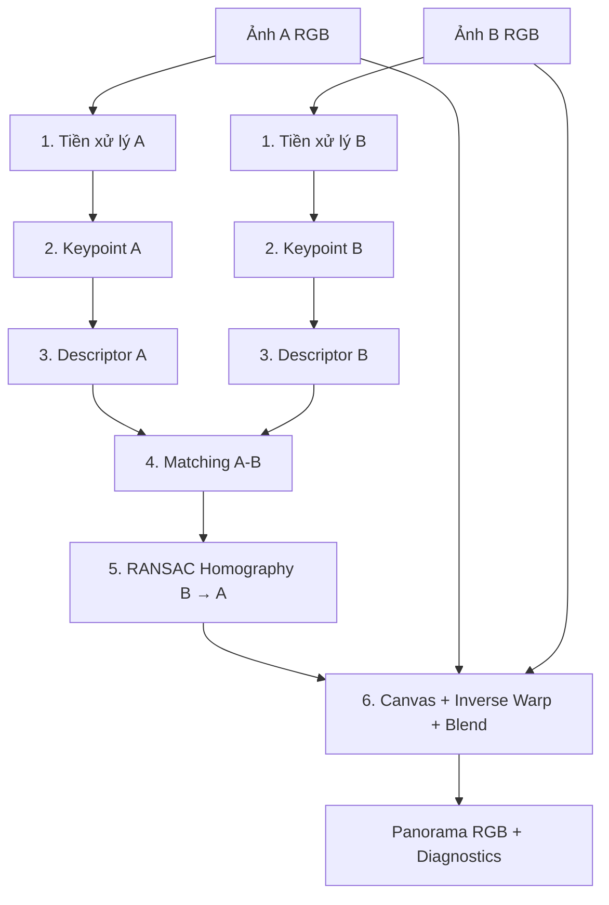
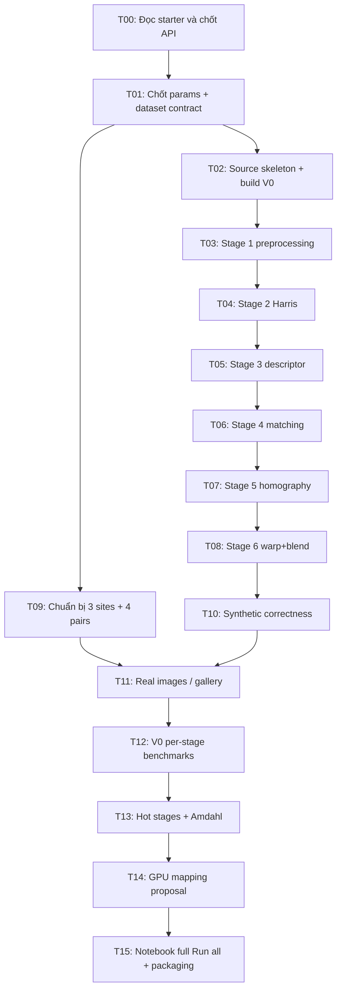

# CSC14120 — MIDTERM SPECIFICATION
## Panorama Image Stitching: Proposal & Sequential Baseline (V0)

> **Mục đích:** Tài liệu thiết kế/đặc tả **trước khi viết code**, làm *single source of requirements* để triển khai **chỉ các hạng mục cần có tại Midterm**. Đây **không phải** báo cáo kết quả và **không khẳng định** đã cài đặt, đo đạc hay kiểm chứng thuật toán.
>
> **Phân biệt nguồn:** **[BẮT BUỘC]** = nội dung nêu trong hai đề PDF; **[THIẾT KẾ ĐỀ XUẤT]** = lựa chọn của tài liệu để nhóm xác nhận và thực hiện; **[CHỜ XÁC MINH]** = phụ thuộc starter notebook/dataset/hardware chưa được cung cấp. Mọi ngưỡng kiểm thử tự đề xuất không phải ngưỡng chấm điểm chính thức.

## Mục lục

1. [Phạm vi, mục tiêu và nguyên tắc](#1-phạm-vi-mục-tiêu-và-nguyên-tắc)
2. [Ma trận truy vết yêu cầu Midterm](#2-ma-trận-truy-vết-yêu-cầu-midterm)
3. [Bài toán và hợp đồng hình học](#3-bài-toán-và-hợp-đồng-hình-học)
4. [Lựa chọn kiến trúc thuật toán](#4-lựa-chọn-kiến-trúc-thuật-toán)
5. [Đặc tả chi tiết sáu giai đoạn](#5-đặc-tả-chi-tiết-sáu-giai-đoạn)
6. [Hợp đồng dữ liệu và giao diện module](#6-hợp-đồng-dữ-liệu-và-giao-diện-module)
7. [Dataset và quản trị tính tái lập](#7-dataset-và-quản-trị-tính-tái-lập)
8. [Kiến trúc repository và trách nhiệm file](#8-kiến-trúc-repository-và-trách-nhiệm-file)
9. [Kế hoạch kiểm thử, correctness và xử lý lỗi](#9-kế-hoạch-kiểm-thử-correctness-và-xử-lý-lỗi)
10. [Đặc tả benchmark và phân tích V0](#10-đặc-tả-benchmark-và-phân-tích-v0)
11. [Kế hoạch GPU trong Midterm (chưa triển khai)](#11-kế-hoạch-gpu-trong-midterm-chưa-triển-khai)
12. [Notebook Midterm: cấu trúc báo cáo](#12-notebook-midterm-cấu-trúc-báo-cáo)
13. [Implementation roadmap, task và tiêu chí hoàn thành](#13-implementation-roadmap-task-và-tiêu-chí-hoàn-thành)
14. [Rủi ro, quyết định mở và nguyên tắc thay đổi](#14-rủi-ro-quyết-định-mở-và-nguyên-tắc-thay-đổi)
15. [Definition of Done và checklist nộp bài](#15-definition-of-done-và-checklist-nộp-bài)
16. [Hướng dẫn sử dụng spec cho coding agent](#16-hướng-dẫn-sử-dụng-spec-cho-coding-agent)
17. [Tài liệu tham khảo và truy xuất nguồn](#17-tài-liệu-tham-khảo-và-truy-xuất-nguồn)

---

# 1. Phạm vi, mục tiêu và nguyên tắc

## 1.1. Mục tiêu nghiệp vụ

Cho hai ảnh RGB **A** và **B** chụp cùng cảnh, có vùng chồng lấp, trả về một ảnh panorama duy nhất. Hệ thống tự động phát hiện các đặc trưng, tìm điểm tương ứng, ước lượng **homography ánh xạ B → A**, biến đổi hình học và ghép ảnh.

Mục tiêu riêng của **Midterm** là có **phương án kỹ thuật minh bạch và V0 tuần tự chạy được, đo được, đúng hình học**, từ đó đưa ra một kế hoạch CUDA có căn cứ. Đây là mốc kiểm chứng trước khi tối ưu song song, không phải mốc đòi hỏi hoàn thành các phiên bản GPU.

## 1.2. In-scope — những việc PHẢI được đặc tả/chuẩn bị

- Thông tin nhóm, MSSV và **kế hoạch phân công đến final**.
- Hiểu bài toán và pipeline 6 stages.
- Chọn phương pháp và giải thích về **chất lượng ảnh + mức phù hợp GPU**, nêu tham số.
- Thiết kế **V0 C/C++ single-thread** theo **interfaces của starter notebook**; không OpenMP, `std::thread`, SIMD viết tay.
- Kịch bản kiểm chứng homography synthetic dựa vào **ground truth**.
- Thu thập/tổ chức ít nhất **3 địa điểm + 3 cặp standard + 1 cặp challenging**; chuẩn hóa 16:9, ba mức phân giải.
- Benchmark V0 từng stage cho small/medium/large; hot stages và xu hướng scale.
- Tính tỉ lệ thời gian dự kiến chuyển GPU `p`, giới hạn speedup theo **Amdahl**.
- Đặc tả kế hoạch V1: stage GPU, thread/block/warp mapping, 2–3 ý tưởng tối ưu và rủi ro.
- Thiết kế notebook Colab có đầu ra lưu sẵn, build từ `src/`, không mã nguồn song song riêng trong notebook.
- Tính tái lập, truy nguồn code bên ngoài và bản quyền.

## 1.3. Out-of-scope — KHÔNG triển khai trong Midterm

- Không viết hay đo các kernel CUDA V1/V2/V3; **chỉ lập kế hoạch**.
- Không bắt buộc đạt speedup GPU hoặc tạo bảng so sánh nhiều phiên bản.
- Không tiến hành Nsight profiling cho GPU chưa tồn tại.
- Không viết final report, final slides hoặc video thuyết trình trong mốc này.
- Không triển khai stitching nhiều hơn hai ảnh/lần chạy; không xây GUI, dịch vụ web, model học sâu.
- Không tự động dùng OpenCV `Stitcher`/`findHomography` để **thay thế toàn bộ logic V0**; các thư viện bên ngoài cần tuân thủ yêu cầu starter và ghi công.

> **Lưu ý phạm vi:** Tài liệu Final yêu cầu tối thiểu 4 phiên bản (V0, V1, ≥2 phiên bản optimized) ở **mốc cuối**; Midterm chỉ yêu cầu **V0 và kế hoạch**. Thiết kế V0 phải có cấu trúc để các phiên bản tương lai dùng cùng dữ liệu và phương pháp, nhưng không tạo nghĩa vụ code CUDA ngay.

## 1.4. Nguyên tắc thiết kế

1. **Correctness trước performance:** panorama đúng hình học là điều kiện tiên quyết.
2. **Một pipeline thống nhất:** mỗi stage có input/output cụ thể; tất cả phiên bản sau này phải tuân thủ cùng lựa chọn thuật toán/tham số để so sánh công bằng.
3. **V0 thật sự tuần tự:** không threading hoặc SIMD thủ công; không chuyển compute sang GPU ngầm.
4. **Deterministic:** seed, tie-break, thứ tự sort, thứ tự ghép ảnh và cấu hình tham số có thể tái lập.
5. **Provenance:** mọi code/phương pháp tham khảo có ghi nguồn trong notebook và đầu file.
6. **Measured, not imagined:** không điền số benchmark hoặc speedup nếu chưa có output thực nghiệm.
7. **Starter-first:** mọi interface/skeleton tồn tại trong notebook khởi đầu có quyền ưu tiên so với tên hàm minh họa trong tài liệu này.

# 2. Ma trận truy vết yêu cầu Midterm

| Requirement ID | Nguồn | Phải xuất hiện trong báo cáo/sản phẩm | Bằng chứng/tiêu chí kiểm tra |
|---|---|---|---|
| MID-01 | Midterm §3.1 | Thành viên, MSSV, work plan theo stage/version | Bảng phân công không để trống khi nộp |
| MID-02 | Midterm §3.2 | Giải thích pipeline | Sơ đồ + diễn giải bằng lời của nhóm |
| MID-03 | Midterm §3.3 | 6 thuật toán, parameters và lý do GPU | Decision table, cấu hình đóng băng |
| MID-04 | Midterm §3.4 | V0 tuần tự đầy đủ, tương thích starter | Executable chạy pipeline; không multithread/SIMD thủ công |
| MID-05 | Midterm §3.5 | Sai số H synthetic vs GT | Bảng/đồ thị sai số từ output notebook |
| MID-06 | Midterm §3.5 | ≥1 panorama/site, ≥3 sites | Ảnh output thực tế trong notebook |
| MID-07 | Midterm §3.5 | Timing per stage cho 3 resolutions | Bảng stage × resolution, unit rõ ràng |
| MID-08 | Midterm §3.5 | Hot stages + scaling | Xếp hạng bottleneck và phân tích theo độ phân giải |
| MID-09 | Midterm §3.5 | Amdahl `p` và upper bound | Công thức + số từ timing V0 |
| MID-10 | Midterm §3.6; Final §1.2 | 3 sites, 3 standard + 1 challenging | Dataset manifest, liên kết raw/prepared |
| MID-11 | Midterm §3.7 | Stage dự định chuyển GPU và mapping | Bảng 6 stages kèm priority/mapping |
| MID-12 | Midterm §3.7 | 2–3 ý tưởng optimization và risks | Ý tưởng gắn với bottleneck giả thuyết/đo được |
| MID-13 | Midterm §2 | `GroupXX_Midterm.ipynb`, `src/` trong ZIP | ZIP đúng tên/nội dung |
| MID-14 | Midterm §2, §4 | Notebook build từ submitted `src/` | Run all ở Colab sau khi cung cấp source/dataset |
| MID-15 | Midterm §4 | Số liệu trong text khớp output | Không có số tự nhập hoặc giả định là thực nghiệm |
| MID-16 | Midterm §2; Final §6 | Tên tác giả và nguồn adapted code tại đầu file; citation | Header tất cả file + References notebook |

**Quy tắc chấp nhận tài liệu:** spec này là bản kế hoạch cho mọi hàng trên; việc đánh dấu `PASS` chỉ được làm **sau khi có code, dataset và notebook chạy thật**.

# 3. Bài toán và hợp đồng hình học

## 3.1. Inputs, outputs và quy ước

- **Image A**: ảnh trái / ảnh làm chuẩn tọa độ; ảnh RGB, kích thước `W_A × H_A`.
- **Image B**: ảnh phải / ảnh cần warp, kích thước `W_B × H_B`.
- **H_BA**: ma trận `3×3` ánh xạ điểm ở **B sang hệ tọa độ A**.
- **Output**: panorama RGB có canvas đủ chứa ảnh A và vùng ảnh B đã chuyển đổi; vùng overlap được blend.
- Trục tọa độ pixel: `x` tăng sang phải, `y` tăng xuống dưới, gốc ở góc trái-trên; điểm pixel được quy ước tại tâm `(x,y)` với `x∈[0,W−1]`, `y∈[0,H−1]`.
- Thứ tự input giữ nguyên qua toàn bộ pipeline; không tự động hoán đổi A/B khi benchmark.

**Biến đổi projective** (dùng tọa độ thuần nhất):

$$
\lambda\begin{bmatrix}x_A\\y_A\\1\end{bmatrix}
=H_{BA}\begin{bmatrix}x_B\\y_B\\1\end{bmatrix},\qquad
H_{BA}=\begin{bmatrix}h_{11}&h_{12}&h_{13}\\h_{21}&h_{22}&h_{23}\\h_{31}&h_{32}&h_{33}\end{bmatrix}.
$$

Khi mẫu số `d=h31*x_B+h32*y_B+h33` khác 0:

$$
x_A=\frac{h_{11}x_B+h_{12}y_B+h_{13}}{d},\quad
y_A=\frac{h_{21}x_B+h_{22}y_B+h_{23}}{d}.
$$

Homography chỉ xác định đến một hệ số tỉ lệ khác 0 (`H` và `cH` tương đương), do đó khi đánh giá không được so trực tiếp chín phần tử chưa chuẩn hóa.

## 3.2. Sơ đồ xử lý và phụ thuộc



Ở **V0**, chạy A rồi B (hoặc ngược lại) một cách tuần tự. Ở kế hoạch **V1**, ba stage đầu của hai ảnh có thể độc lập để nghiên cứu stream sau này, nhưng chưa triển khai ở Midterm.

## 3.3. Các giả định về cảnh chụp

- Chụp đứng tại một vị trí, **xoay camera thay vì đi ngang** để giảm parallax; vùng overlap **30–50%** theo Final §1.2.
- Cảnh chủ yếu tĩnh, không bị mờ chuyển động nghiêm trọng, độ phơi sáng giữa hai ảnh không chênh quá lớn.
- Mô hình homography phù hợp tốt cho cảnh phẳng hoặc camera quay quanh gần tâm quang học; **không thể sửa hoàn hảo parallax** do dịch chuyển camera.
- Ảnh challenging cố ý vi phạm một hoặc nhiều điều kiện lý tưởng; yêu cầu là phân tích giới hạn, không cam kết ghép thành công mọi ảnh.

# 4. Lựa chọn kiến trúc thuật toán

## 4.1. Quyết định khởi điểm: Harris + oriented BRIEF + Hamming + RANSAC

**[THIẾT KẾ ĐỀ XUẤT — cần nhóm xác nhận trước implementation]**

| Stage | Chọn cho V0 | Lý do chất lượng | Lý do thuận lợi cho GPU sau này | Đánh đổi |
|---|---|---|---|---|
| 1. Preprocessing | RGB → grayscale float; Gaussian separable | Giảm nhiễu, ổn định corner | Per-pixel + convolution separable | Blur quá mạnh làm mất chi tiết |
| 2. Keypoint | Harris response → NMS → top-K | Corner rõ rệt, dễ diễn giải | Pixel parallel; NMS/local; top-K cần compaction | Không bất biến theo scale, sorting |
| 3. Description | BRIEF 256-bit có xoay theo orientation từ intensity centroid (ORB-style, **không phải toàn bộ ORB**) | Chống xoay trong mặt phẳng tốt hơn BRIEF cố định | Descriptor độc lập/keypoint, biểu diễn 8×32-bit | Nhạy với scale/blur; đọc bộ nhớ ngẫu nhiên |
| 4. Matching | Brute-force Hamming; nearest/second; ratio test + mutual check | Loại match mơ hồ, ngưỡng giải thích được | Pairwise / popcount | O(K_A·K_B), có thể là hot stage |
| 5. Homography | 4-point normalized DLT + RANSAC + refit inliers | Chịu outlier, phù hợp stitching | Nhiều hypothesis độc lập; reductions | Suy biến, nhiễu, chọn ngưỡng |
| 6. Warping/blending | Bounding canvas, inverse warp bilinear, feather weights | Giảm lỗ ảnh, seam ít đột ngột | Per-output-pixel gather | Có thể ghosting, mất ảnh nếu H xấu |

**Vì sao không dùng SIFT/OpenCV Stitcher làm core:** SIFT-like descriptor nặng hơn và cần thuật toán GPU phức tạp; Stitcher che khuất stage timings và tính công bằng tự cài pipeline. Dùng thư viện đọc/ghi ảnh có thể hợp lý nếu đúng starter. Được phép tham khảo mã nguồn bên ngoài có trích dẫn, nhưng phải giải thích được mã dùng.

**Ràng buộc thay đổi:** Nếu thử nghiệm trên dataset ban đầu chứng minh oriented BRIEF thất bại nghiêm trọng (đặc biệt khi thay đổi tỉ lệ, texture yếu), phải lập *Decision Record* trước khi khóa baseline. Không được âm thầm đổi thuật toán giữa V0 và GPU trong bảng speedup final.

## 4.2. Bộ tham số đề xuất — bản khóa V0 ứng viên

| Tham số | Giá trị đề xuất | Ghi chú |
|---|---:|---|
| `grayscale_weights` | `(0.299, 0.587, 0.114)` | RGB tuyến tính hóa không bắt buộc; nhất quán tất cả ảnh |
| `gaussian_ksize` | `5` | Kernel 1D hai lượt, xử lý border thống nhất |
| `gaussian_sigma` | `1.2` | Đơn vị pixel |
| `harris_k` | `0.04` | Hằng số Harris |
| `harris_nms_window` | `3×3` | Strict local maximum + tie-break |
| `harris_rel_threshold` | `0.01 × max_positive_R` | Nếu không có response dương thì zero keypoints |
| `max_keypoints_per_image` | `1500` | Tối đa; số thực tế có thể thấp hơn |
| `brief_bits` | `256` | 8 word × 32 bit |
| `brief_patch_radius` | `15` | Exclude keypoints sát biên |
| `brief_pattern_seed` | `2026` | Tạo pattern **một lần**, ghi version/hash trong report |
| `match_ratio_threshold` | `0.80` | `d1/d2 < threshold`, khi `d2 > 0` |
| `match_mutual_check` | `true` | Nearest từ hai hướng phải trùng |
| `ransac_seed` | `2026` | PRNG cố định trên mỗi cặp/độ phân giải |
| `ransac_max_iterations` | `2000` | Cố định để dễ kiểm chứng |
| `ransac_base_threshold_px` | `3.0` | Ở 1920px chiều rộng; scale theo width |
| `ransac_min_inliers` | `8` | Chỉ số an toàn nội bộ, **không phải yêu cầu đề** |
| `resampling` | `bilinear` | Inverse mapping |
| `blending` | `feather` | Theo khoảng cách đến biên vùng hợp lệ |
| `benchmark_runs` | `5` | Ít nhất 5, theo Final §4 |

**Nguyên tắc cấu hình:** Freeze giá trị khi đã chọn phương án. Các phiên bản cùng độ phân giải phải có **cùng phương pháp, tham số, seed, input và output contract**. Đối với RANSAC, cho độ rộng `W` áp dụng `threshold_px = 3.0*(W/1920)` (nếu hai ảnh khác width, dùng width ảnh A); đây là **quy tắc tham số hóa được định nghĩa trước**, không phải tune lại bằng tay sau benchmark.

# 5. Đặc tả chi tiết sáu giai đoạn

## 5.1. Stage 1 — Preprocessing

**Input:** `ImageRGB A/B`. **Output:** `GrayImage` float32, `SmoothedGray` float32. Không làm thay đổi input RGB.

**Lý thuyết:** Grayscale theo tổ hợp kênh:

$$I(x,y)=0.299R(x,y)+0.587G(x,y)+0.114B(x,y).$$

Gaussian smoothing:

$$G_\sigma(x,y)=\frac{1}{2\pi\sigma^2}e^{-\frac{x^2+y^2}{2\sigma^2}},\quad I_s=G_\sigma*I.$$

Tính chất phân tách Gaussian cho phép tính hai convolution 1D ngang/dọc thay convolution 2D. Nếu kích thước kernel là `k`, phép tính trên một pixel từ khoảng `O(k²)` giảm thành khoảng `O(2k)` (không tính tối ưu compiler).

**Thiết kế V0:** grayscale lần lượt mỗi pixel; blur ngang rồi dọc; kernel chuẩn hóa tổng trọng số bằng 1. Border dùng **clamp-to-edge** (đặt trong config chung) để tránh đọc ngoài ảnh. Mọi buffer khởi tạo rõ ràng. Không đo thời gian giải mã ảnh vào `Stage 1`.

**Điều kiện pass:** ảnh màu hằng → grayscale/blur đồng nhất; ảnh gradient → blur không sinh NaN, không đổi kích thước; blur của ảnh hằng giữ giá trị gần đúng. Dùng phép so float có tolerance được ghi trong test.

**Dự báo parallelism:** 1 thread/pixel cho grayscale; 1 thread/pixel cho mỗi pass blur; về sau có thể dùng tiled shared memory với halo.

## 5.2. Stage 2 — Keypoint detection (Harris)

**Input:** ảnh xám đã smooth. **Output:** danh sách điểm `(x,y,response)` tối đa `K`, thứ tự ổn định.

**Lý thuyết:** với gradient `I_x, I_y` (có thể dùng Sobel 3×3), tại mỗi điểm định nghĩa second-moment matrix sau cộng trọng số trong một cửa sổ:

$$M=\begin{bmatrix}S_{xx}&S_{xy}\\S_{xy}&S_{yy}\end{bmatrix},\quad
S_{xx}=G*I_x^2,\;S_{yy}=G*I_y^2,\;S_{xy}=G*(I_xI_y).$$

Đáp ứng Harris:

$$R=\det(M)-k\,[\operatorname{trace}(M)]^2
=S_{xx}S_{yy}-S_{xy}^2-k(S_{xx}+S_{yy})^2.$$

`R` lớn, dương thường tương ứng corner; vùng phẳng ít tín hiệu; edge mạnh có thể có `R < 0`.

**Thiết kế V0:**

1. Tính gradient (Sobel hoặc central difference — chốt **Sobel 3×3** để có hướng ổn định).
2. Smooth tích gradient bằng Gaussian `5×5`, `sigma=1.2` (dùng cùng hàm filter, bộ nhớ tạm riêng).
3. Tính `R`, loại các pixel `R <= 0` và dưới ngưỡng tương đối.
4. Non-maximum suppression `3×3`; tie-break khi bằng nhau: pixel `(y,x)` nhỏ hơn thắng.
5. Loại điểm cách biên ít hơn `brief_patch_radius + 2` pixel; sau đó lấy top-K bằng thứ tự `R` giảm dần, `(y,x)` tăng dần. Có thể dùng heap kích thước `K` để giảm chi phí so với sort toàn ảnh.

**Pass:** ảnh đồng nhất → 0 keypoints; ảnh bàn cờ → xuất hiện corners; không keypoint nào ngoài biên descriptor; số keypoints `<= K`; chạy lại cho thứ tự giống hệt.

**Rủi ro:** `top-K` tập trung tại vùng có nhiều texture, mất phân bố toàn ảnh. Nếu quan sát được vấn đề, cân nhắc grid-based spatial quotas qua change record **trước khi chốt V0**; nếu đã chốt thì không thay đổi riêng ở bản GPU.

## 5.3. Stage 3 — Oriented BRIEF descriptor

**Input:** `SmoothedGray`, `Keypoints`. **Output:** 1 descriptor 256 bit + orientation cho mỗi keypoint hợp lệ.

**Lý thuyết:** BRIEF so sánh cường độ ở 2 vị trí quanh keypoint:

$$b_i=\mathbf{1}\{I_s(p_i)<I_s(q_i)\},\quad i=0,\ldots,255.$$

Ghép `b_i` thành vector nhị phân 256 bit; khoảng cách Hamming là số bit khác nhau. Với orientation ước lượng bằng intensity centroid trên patch:

$$m_{pq}=\sum_{(x,y)\in\Omega}x^py^q I_s(x,y),\qquad
\theta=\operatorname{atan2}(m_{01},m_{10}),$$

xoay các cặp offset `(p_i,q_i)` bởi `R(θ)` trước khi lấy mẫu ảnh. Kỹ thuật này **lấy cảm hứng từ ORB**, không được tự tuyên bố đã cài đặt đầy đủ detector ORB (vì detector đang là Harris, không có image pyramid/FAST theo ORB gốc).

**Thiết kế V0:** pattern 256 cặp điểm pseudo-random trong bán kính 15, được sinh deterministic một lần; pattern cố định cùng toàn bộ cặp dữ liệu và độ phân giải. Dùng bilinear sampling tại offset xoay, giới hạn patch trong ảnh. Tích các bit thành `uint32_t[8]` với thứ tự bit quy ước (`bit 0` là LSB của word 0). Orientation patch tính theo cường độ đã blur.

**Pass:** cùng keypoint/patch → cùng descriptor; đảo các pixel được chọn trong fixture đơn giản → bit thay đổi có thể dự đoán; Hamming từ descriptor tự khớp bằng 0; không đọc vượt biên.

**Rủi ro:** cấu trúc patch cố định pixel không bất biến với thay đổi tỉ lệ; descriptor có thể thiếu ổn định khi scene ít texture, perspective mạnh. Đây là yếu tố cần báo cáo ở challenging pair.

## 5.4. Stage 4 — Descriptor matching

**Input:** descriptor A và B. **Output:** danh sách `Match(index_A,index_B,distance,ratio)` đã lọc.

**Lý thuyết:**

$$d_H(a,b)=\operatorname{popcount}(a\oplus b).$$

Với descriptor 256-bit chia làm tám `uint32_t`, khoảng cách bằng tổng popcount của tám từ XOR. Tìm hàng xóm gần nhất và gần thứ hai trong ảnh đối diện; Lowe-style ratio test:

$$\frac{d_1}{d_2}<\tau,\qquad \tau=0.80,\quad d_2>0.$$

Kết hợp **mutual nearest neighbor**: B được A chọn cũng phải chọn lại A làm gần nhất.

**Thiết kế V0:** dò mọi cặp `(i,j)` không dùng giới hạn vị trí không có chứng minh; nearest/second từ A→B, nearest từ B→A; reject ratio mơ hồ; cross-check; sắp xếp match `(index_A,index_B)` ổn định. Trường hợp `d2=0` thì reject vì không phân biệt được match; nếu mỗi ảnh có quá ít descriptor để có hai ứng viên thì trả lỗi giai đoạn matching thay vì chia 0.

**Độ phức tạp:** `O(K_A*K_B*8)` phép xor/popcount 32-bit (chưa tính overhead). Đây là **ứng viên** hot stage chứ chưa kết luận khi thiếu profiler.

**Pass:** matching không sinh index ngoài khoảng, duy nhất theo A và (sau cross-check) B; giống nhau → distance=0; descriptor hoàn toàn giống lặp lại → reject ambiguity theo luật được công bố.

## 5.5. Stage 5 — RANSAC homography

**Input:** matches + tọa độ keypoints. **Output:** `H_BA`, mask inliers, thống kê residual, trạng thái thành công/thất bại.

**Lý thuyết:** mỗi correspondence cung cấp `(x_B,y_B) -> (x_A,y_A)`; một homography không suy biến có 8 bậc tự do, 4 correspondence độc lập đủ cho nghiệm tối thiểu. RANSAC liên tục lấy mẫu bốn match, ước lượng H, kiểm tra điểm khớp hình học và chọn giả thuyết có nhiều inlier nhất.

Sai số tái chiếu một chiều (B→A):

$$e_i=\left\|\pi\left(H_{BA}[x_{B,i},y_{B,i},1]^T\right)-[x_{A,i},y_{A,i}]^T\right\|_2.$$

Một cặp là inlier nếu `e_i < t_px`. Có thể giải hệ phương trình tuyến tính **8×8** khi cố định `h33=1` trong hệ tọa độ đã chuẩn hóa; trước khi solve, thực hiện **Hartley point normalization** (dịch trung tâm về gốc, đưa khoảng cách trung bình tới `√2`) để giảm bất ổn số. Sau khi giải, khử chuẩn hóa và chuẩn hóa scale H. Với trường hợp chuẩn hóa khiến `h33≈0`, phải có cách scale theo norm ma trận và validation rõ ràng, không chia 0.

**Quy trình V0:**

1. Validate số match `>=4`, tọa độ finite, không trùng và mẫu không gần đồng tuyến.
2. Dùng `mt19937(seed cố định)` lấy 4 chỉ số **khác nhau** ở mỗi hypothesis.
3. Solve H bằng normalized DLT (8 ẩn) với Gaussian elimination có pivoting hoặc solver số học nhỏ tương đương; reject hệ singular/ill-conditioned.
4. Đếm inliers theo reprojection error, tie-break bằng tổng lỗi inlier nhỏ hơn, sau đó iteration index nhỏ hơn.
5. Chọn H tốt nhất; dùng tất cả inlier fit lại least squares có normalization (không lặp tới khi đổi kết quả tùy hứng); rescore inliers.
6. Kiểm tra H invertible, finite, tỷ lệ canvas an toàn và inliers đủ theo ngưỡng đã chọn.
7. Trả diagnostic (số matches, số inliers, mean/median residual) phục vụ notebook.

**Xác suất RANSAC:** với xác suất inlier `w`, sample size 4, sau `N` iterations:

$$P(\text{ít nhất 1 mẫu all-inlier})=1-(1-w^4)^N.$$

Đây là lý do phải kiểm tra `w` thực tế; 2000 vòng không cam kết thành công cho trường hợp tỷ lệ outlier quá lớn.

**Pass:** test biến đổi identity, translation, affine và perspective tổng hợp; GT kiểm tra bằng corner mapping; outliers thêm vào phải được loại phần lớn; không được cho ra `NaN`/canvas khổng lồ ở input suy biến.

## 5.6. Stage 6 — Canvas, inverse warp và feather blending

**Input:** ảnh RGB A, RGB B, `H_BA`. **Output:** panorama RGB và valid masks/diagnostics.

**Quy tắc canvas:** project bốn góc B qua `H_BA`, lấy min/max theo cả bốn góc A và bốn góc B đã biến đổi. Tạo translation `T` để mọi điểm có tọa độ canvas không âm. Warp A bằng dịch chuyển `T`; warp B bằng `T*H_BA`. Dùng `floor/ceil` và quy ước tâm pixel để tránh crop nhầm rìa; kiểm tra overflow, canvas bị phóng đại vô lý và `H` gần singular.

**Lý thuyết inverse warping:** mỗi pixel output `q=(x_c,y_c)` có vị trí trong hệ A là `T^{-1}q`, trong hệ B là:

$$p_B=H_{BA}^{-1}T^{-1}q.$$

**Không** forward-splat từng pixel B vì dễ sinh lỗ; lấy mẫu màu B bằng bilinear interpolation từ bốn pixel lân cận. Nếu điểm nằm ngoài biên source thì đánh dấu mask không hợp lệ, **không** suy ra invalid chỉ vì màu đen `(0,0,0)`.

**Blending:** tại vùng A-only giữ màu A, B-only giữ B. Tại overlap, tính độ tin cậy `w_A,w_B` từ khoảng cách tới biên vùng hợp lệ của từng ảnh rồi:

$$C_{out}=\frac{w_A C_A+w_B C_B}{w_A+w_B},\qquad w_A+w_B>0.$$

Có thể dùng khoảng cách tới biên ảnh nguồn (được truyền theo warp), kèm `ε>0` để mẫu nằm đúng biên không gây chia 0. Vùng không có đóng góp ảnh nào được điền màu nền (ví dụ đen) và có mask riêng. Không tự động crop vùng đen nếu chưa xác định quy tắc nhất quán.

**Pass:** H identity ghép hai ảnh trùng nhau không tạo biên sai; translation đơn giản đúng chiều; không có pixel chưa khởi tạo; ảnh đen hợp lệ không bị hiểu là thiếu dữ liệu; canvas có kích thước hợp lệ, vùng source không mất bất thường.

## 5.7. Khi pipeline thất bại

| Điều kiện | Cách xử lý bắt buộc trong thiết kế | Không được làm |
|---|---|---|
| Không có corners / quá ít descriptor | Trả status `INSUFFICIENT_FEATURES` với counters | Đọc buffer rỗng |
| Không đủ ≥4 matches | Trả `INSUFFICIENT_MATCHES` | Giả lập homography identity rồi báo thành công |
| Mẫu RANSAC suy biến | Bỏ sample, tiếp tục vòng lặp hữu hạn | Chia 0 / nhận NaN |
| Không có hypothesis tin cậy | `HOMOGRAPHY_FAILED` kèm diagnostics | Xuất ảnh đẹp giả/khẳng định đã stitch |
| H không khả nghịch, canvas quá lớn | `INVALID_WARP_GEOMETRY` | Cấp phát vô hạn hoặc crash |
| Cặp challenging thất bại | Lưu lỗi thực và giải thích trong report | Cắt bỏ test khỏi dataset/nhận xét |

# 6. Hợp đồng dữ liệu và giao diện module

> **[CHỜ XÁC MINH]** PDF Midterm yêu cầu dùng *interfaces in the starter notebook*, nhưng hai PDF được cung cấp **không chứa starter notebook hoặc khai báo hàm thực tế**. Tên kiểu/hàm dưới đây là **hợp đồng logic**, không phải chữ ký C/C++ được giảng viên xác nhận. Ngay khi nhận starter, phải lập *interface mapping* và ưu tiên giữ nguyên API starter.

## 6.1. Data model logic

| Entity logic | Trường tối thiểu | Invariants |
|---|---|---|
| `RGBImage` | `width`, `height`, `channels=3`, `pixels`, `stride/row_pitch` | Ảnh RGB 8-bit liên tục hoặc stride rõ ràng; buffer sống đủ lâu |
| `GrayImage` | `width`, `height`, `float_pixels` | Đơn kênh; không NaN; cùng tọa độ nguồn |
| `Keypoint` | `x`, `y`, `response`, `orientation` | Pixel thuộc ảnh; có margin hợp lệ; giá trị finite |
| `Descriptor256` | `words[8]` | Tổng 256 bit; thứ tự little bit within each word cố định |
| `FeatureSet` | `keypoints`, `descriptors` | `len(keypoints)==len(descriptors)`; descriptor gắn đúng index |
| `Match` | `index_A`, `index_B`, `distance`, `ratio` | Index hợp lệ, distance `∈[0,256]`, định hướng A→B |
| `Homography` | `H_BA[3][3]`, `inlier_mask`, stats, valid | Biến đổi B→A; H finite và invertible khi valid |
| `PanoramaResult` | `RGBImage`, coverage flags, status | Kích thước dương, không vượt giới hạn cấp phát |
| `StageTiming` | 6 stage times, total_compute, metadata | ms; thống nhất phạm vi đo; một source of truth |
| `RunConfig` | algorithm params, seed, version, runs | Serialize/log lại được; không có tham số ngầm |

**Quy tắc ownership:** cấp phát/giải phóng buffer thuộc lớp caller hoặc wrapper RAII; stage không được trả pointer vào stack; ảnh gốc không bị biến đổi; output của stage không mang trạng thái ẩn từ lần chạy trước. Nếu dùng `std::vector` chỉ thực hiện trên một luồng V0.

## 6.2. Hợp đồng từng stage (API mức thiết kế)

| Module/operation logic | Input | Output | Lỗi hợp lệ |
|---|---|---|---|
| `preprocess(image, config)` | RGB | blurred grayscale | invalid image/size |
| `detect_keypoints(gray, config)` | grayscale | ordered keypoints | empty features (có thể trả status) |
| `describe(gray, keypoints, config)` | gray, keypoints | aligned descriptors | invalid border/descriptor |
| `match_features(featuresA, featuresB, config)` | features | filtered matches | too few descriptors/matches |
| `estimate_homography(matches, pointsA, pointsB, config)` | correspondences | H_BA, inliers, diagnostics | degenerate/failed H |
| `warp_blend(A, B, H_BA, config)` | RGB inputs, H | panorama, masks | invalid canvas/transform |
| `stitch_v0(A, B, config)` | two images | panorama, diagnostics, stage times | propagate concrete status |

### Giới hạn trách nhiệm

- **Core algorithm:** không biết file path, notebook, Google Drive hoặc cách render Matplotlib.
- **Image I/O:** đọc/ghi màu, không thực hiện thuật toán stitching.
- **Runner/CLI:** parse arguments, chọn version, gọi pipeline, thu timings, in report; không chứa logic Harris/RANSAC.
- **Benchmark:** quản lý runs, warm-up, thống kê; không tính lại kết quả từ hình ảnh khác so với run.
- **Notebook:** orchestration + kết quả/giải thích; **không chứa bản copy của C++/CUDA implementation**.

## 6.3. CLI mục tiêu và output thống nhất

**[BẮT BUỘC cho Final, nên chuẩn bị ngay ở V0]** Giao diện run cuối cùng được quy định:

```text
./stitch <left_image> <right_image> <output_image> --version <0|1|2|...> [--runs N]
```

Đối với Midterm: `--version 0` là phiên bản duy nhất cần chạy. Các version khác chưa triển khai có thể báo `unsupported version` rõ ràng. Nếu starter đã có cách chạy khác, giữ tương thích starter trước và chuẩn hóa command tương đương trong notebook.

**Stdout machine-readable [ĐỀ XUẤT]:** `version`, `pair_id`, `resolution`, `seed`, `image_A/B dimensions`, `N_keypoints_A/B`, `N_matches`, `N_inliers`, `H_BA`, `stage_times_ms`, `total_compute_ms`, `status`, `gpu_name` (nếu có). Dùng JSON line hoặc TSV/CSV có header ổn định. Notebook **parse output chương trình**, tránh gõ tay số.

**Stderr:** diagnostics/error message; exit code 0 khi panorama hợp lệ, nonzero cho lỗi I/O hoặc pipeline. Không in danh sách hàng nghìn keypoint ra stdout trong benchmark.

## 6.4. Hợp đồng kết quả và reproducibility

- Hệ tọa độ H thống nhất B→A ở source và notebook.
- Cùng ảnh + cùng config + seed → cùng số keypoints, matches, H và panorama (trong cùng build/platform; sai số floating-point có tolerance).
- Không có alias output image với input image khi warp.
- Benchmark các version dùng cùng branch tham số; không "âm thầm" giảm iterations ở V1 để tăng speedup.
- Các counter trung gian là output thật của pipeline, không hardcode trong notebook.

# 7. Dataset và quản trị tính tái lập

## 7.1. Dataset minimum từ đề

**[BẮT BUỘC]** Nhóm tự chụp ảnh tại **ít nhất ba địa điểm khác nhau** và không trùng địa điểm nhóm khác theo quy định đăng ký. Tối thiểu:

- **3 cặp standard:** mỗi địa điểm ít nhất một cặp; mỗi cặp có hai ảnh A/B.
- **1 cặp challenging:** có đặc trưng khó (ít texture, hoa văn lặp, người chuyển động, thiếu sáng, v.v.). Có thể lấy tại một trong ba địa điểm nếu hợp lệ theo đăng ký và hướng dẫn lớp.
- **Mỗi cặp** được crop 16:9 và resize ở **ba độ phân giải**: `1280×720`, `1920×1080`, `3840×2160`.
- Ảnh raw và toàn bộ `dataset/` đã chuẩn bị được cung cấp qua **link dataset** trong notebook.

**Kết quả chuẩn bị tối thiểu:** `4 pairs × 3 resolutions = 12 prepared image pairs = 24 prepared RGB files` (nếu có đúng 3 standard + 1 challenging; không tính raw/synthetic). Con số này là phép đếm thiết kế, **không phải benchmark**.

## 7.2. Cách chụp

- Cố định vị trí chân máy/người chụp; **xoay** sang hướng khác, không bước ngang; overlap mục tiêu 30–50%.
- Giữ orientation camera thống nhất (landscape), cố gắng cố định exposure/focus/white balance.
- Chụp raw đủ độ phân giải cho mức large; nếu nguồn nhỏ hơn `3840×2160` thì ảnh large bị upscale, cần khai báo vì kết quả scaling vẫn đo được nhưng ít đại diện cho ảnh thật 4K.
- Ghi metadata: `site_id`, mô tả cảnh, ngày chụp (nếu cần), nhóm đăng ký, overlap ước lượng, yếu tố challenging, tên file A/B.
- Chỉ crop và resize, **không chỉnh ảnh khác nhau giữa các version**. Định hướng EXIF phải được áp dụng trước crop để tránh ảnh đọc bị xoay bất ngờ.

## 7.3. Định dạng thư mục dataset đề xuất

```text
dataset/
├── manifest.csv
├── raw/
│   ├── site_01_standard/{A_original.jpg,B_original.jpg}
│   ├── site_02_standard/{A_original.jpg,B_original.jpg}
│   ├── site_03_standard/{A_original.jpg,B_original.jpg}
│   └── site_XX_challenging/{A_original.jpg,B_original.jpg}
├── prepared/
│   ├── small/
│   │   ├── site_01_standard/{A.png,B.png}
│   │   ├── site_02_standard/{A.png,B.png}
│   │   ├── site_03_standard/{A.png,B.png}
│   │   └── site_XX_challenging/{A.png,B.png}
│   ├── medium/                 # cùng 4 pair IDs
│   └── large/                  # cùng 4 pair IDs
└── synthetic/                  # theo starter nếu có; KHÔNG tự thay thế fixture chấm
```

**Manifest đề xuất:** `pair_id,site_id,kind,registered_site,raw_A,raw_B,small_A,small_B,medium_A,medium_B,large_A,large_B,notes`. Dataset link trong notebook trỏ đến cả `raw/` và `prepared/`.

## 7.4. Quy trình chuẩn hóa (chưa viết script)

1. Kiểm tra raw A/B cùng một pair thực sự overlap.
2. Fix ảnh về RGB 3 kênh, xử lý orientation và crop **cùng tỷ lệ 16:9** nhưng không ép cùng nội dung không gian.
3. Resize từng ảnh cùng một cặp sang ba size bằng interpolation nhất quán (ví dụ bicubic hoặc bilinear — phải chốt và ghi rõ).
4. Validation ảnh tồn tại, decode được, kích thước/ratio chính xác.
5. (Đề xuất) Tính SHA-256 hoặc ghi manifest phiên bản dataset để benchmark không thay ảnh giữa các lần.
6. Lưu raw bất biến; nếu re-crop vì ảnh kém, đánh dấu dataset revision, không trộn số benchmark ở các revision.

## 7.5. Synthetic pair và ground truth

**[BẮT BUỘC]** Midterm yêu cầu lỗi homography trên **synthetic pair so với ground truth**. Tuy nhiên, hai PDF không cung cấp ảnh synthetic, H ground truth, cách sinh hoặc API để lấy ground truth. Phải lấy fixture từ **starter notebook** trước khi chốt acceptance threshold.

**Thiết kế fallback chỉ để unit test nội bộ (không thay fixture starter):** chọn một ảnh đã biết, warp bởi homography có chủ đích; tạo hai crop có overlap; lưu `H_GT` với quy ước B→A; test identity, translation, perspective nhẹ và outliers. Dùng **tập synthetic do starter cung cấp** làm căn cứ chính của notebook nộp.

# 8. Kiến trúc repository và trách nhiệm file

## 8.1. Nguyên tắc: không làm hỏng skeleton đề

Midterm mô tả `src/` với **các file gợi ý/khung**:

- `common.h`, `cuda_utils.cuh`, `versions.h`, `main.cu`, `stb_impl.cpp`.
- `v0_<name>.cpp` cho baseline.
- Các `.c/.cpp/.h/.cu/.cuh` khác khi cần.

Tên trên là tên phải đối chiếu với bộ **starter thực tế**: không được tự tạo chữ ký hàm giả rồi giả định Colab đã có. Cần kiểm tra ai chịu trách nhiệm entry point, data struct và timing callback trong notebook trước khi chia module.

## 8.2. Layout phát triển đề xuất

```text
CSC14120-panorama/
├── docs/
│   ├── MIDTERM_SPEC.md                 # bản spec hiện tại (đổi tên khi đưa vào repo)
│   ├── DECISIONS.md                    # ADR: quyết định/đổi thuật toán
│   └── TEST_PLAN.md                    # có thể tách từ §9 nếu team muốn
├── src/                                # SOURCE OF TRUTH, đưa vào zip
│   ├── common.h                        # theo starter, shared types
│   ├── versions.h                      # theo starter, version-facing interface
│   ├── cuda_utils.cuh                  # theo starter, có thể chưa dùng trong V0
│   ├── main.cu                         # theo starter, CLI/dispatch
│   ├── stb_impl.cpp                    # stb implementation/attribution
│   ├── v0_stitch.cpp                   # single-thread orchestrator
│   ├── image_preprocess.h
│   ├── image_preprocess.cpp
│   ├── harris.h
│   ├── harris.cpp
│   ├── brief.h
│   ├── brief.cpp
│   ├── matcher.h
│   ├── matcher.cpp
│   ├── homography.h
│   ├── homography.cpp
│   ├── warp_blend.h
│   ├── warp_blend.cpp
│   ├── timing.h
│   └── timing.cpp
├── tests/                              # dev-only; tùy chọn có trong zip
│   ├── unit/
│   └── fixtures/
├── scripts/                            # dev-only: chuẩn bị/validate dataset
├── dataset/                            # dữ liệu ngoài ZIP, notebook có link
├── outputs/                            # kết quả chạy local; không hardcode
├── GroupXX_Midterm.ipynb               # report thực tế cần nộp
├── README.md                           # internal dev; không bắt buộc theo Midterm ZIP
└── .gitignore
```

**Không ép tách thành nhiều `.cpp` nếu starter yêu cầu file cụ thể.** Có thể gộp stage nhẹ hoặc khai báo nội bộ trong `v0_stitch.cpp` nếu phù hợp, miễn bảo đảm khả năng đo thời gian riêng từng stage và không duplicate code giữa V0/GPU về sau.

## 8.3. Ranh giới file và trách nhiệm

| File/nhóm file | Trách nhiệm | Không được chứa |
|---|---|---|
| `common.h` | Struct/enum/config chung, tọa độ, status | Global mutable state ngẫu nhiên |
| `versions.h` | Contract dispatch pipeline theo starter | Thuật toán Harris/RANSAC chi tiết |
| `main.cu` | Parse CLI, chọn version, I/O glue | Code lặp lại 6 stages |
| `v0_stitch.cpp` | Điều phối stage V0, timing và error propagation | OpenMP/std::thread/CUDA kernels |
| `image_preprocess.*` | Grayscale, convolution separable | File I/O/network |
| `harris.*` | Gradient, corner response, NMS, top-K | RANSAC/warp |
| `brief.*` | Orientation và descriptor | Matching all-pairs |
| `matcher.*` | Hamming, ratio, mutual-check | Geometry transform |
| `homography.*` | Sample, solve, RANSAC, GT helpers | Image blending |
| `warp_blend.*` | Canvas, mask, bilinear, feather | Feature detection |
| `timing.*` | CPU stage timing, thống kê có thể serialize | Biến đổi ảnh |
| `stb_impl.cpp` | Implementation image lib theo starter và license | Giải thuật stitching |
| Notebook | Build/call code, tạo bảng/chart/panorama, diễn giải | Bản sao C/C++ dùng thay `src/` |

## 8.4. Ghi nguồn và bản quyền

**[BẮT BUỘC]** Mỗi file nhóm **viết hoặc sửa** cần header: tác giả và nguồn bên ngoài nếu adapted. Mã từ STB hoặc tutorial (nếu được dùng) phải giữ license, ghi rõ đường dẫn và phần nào tham khảo; thư viện có license riêng không được xóa attribution. Notebook có mục References + AI usage declaration (áp dụng theo final spec học thuật; chuẩn bị sớm để không thiếu ở final).

**Quy trình Git đề xuất:** nhánh `feature/stage1-preprocess`, `feature/stage2-harris`, …; PR review source + interface + test trước khi merge; không đặt binary dataset lớn trong repo nếu chưa có Git LFS/quy ước nhóm. Đây là khuyến nghị quy trình, không phải yêu cầu môn.

## 8.5. Thao tác notebook với source

Notebook (1) lấy `src/` từ ZIP upload hoặc Drive chung, (2) build theo lệnh xác nhận trong starter, (3) chạy executable V0, (4) parse stdout/result files, (5) hiển thị bảng/plot/panorama. Nếu chạy `Runtime → Run all` ở Colab tươi, **không** phụ thuộc một cell đã chạy thủ công trước đó, không viết lại source bằng `%%writefile` để tạo bản khác với ZIP.

# 9. Kế hoạch kiểm thử, correctness và xử lý lỗi

## 9.1. Chiến lược nhiều tầng

- **Unit tests:** stage-level invariants, ảnh vài pixel và synthetic data nhỏ.
- **Integration tests:** ảnh cặp có shift/perspective biết trước, nhận `H_BA` và panorama.
- **Official midterm synthetic test:** dùng fixture/H_GT của starter, bảng sai số theo quy định.
- **Dataset acceptance:** ≥3 panorama standard; chạy được 3 resolutions; challenging pair có phân tích.
- **Reproducibility:** seed giữ nguyên và chạy lại kết quả không đổi quá tolerance; benchmark không bị lẫn output từ run khác.

## 9.2. Test matrix trước khi code

| Test ID | Tình huống | Cần kiểm chứng | Acceptance nội bộ đề xuất |
|---|---|---|---|
| UT-01 | Gray RGB màu chuẩn | Conversion/dimensions | Pixel đúng công thức ± tolerance |
| UT-02 | Gaussian ảnh đồng nhất | Kernel normalized, borders | Giữ màu (sai số float rất nhỏ) |
| UT-03 | Harris ảnh phẳng | Không sinh corners giả | 0 keypoints |
| UT-04 | Harris ảnh bàn cờ | Corner/NMS/top-K | Nhiều keypoints hữu hạn; đúng count bound |
| UT-05 | BRIEF lặp cùng patch | Determinism | Descriptor giống từng bit |
| UT-06 | Hamming với pattern biết trước | Popcount | Khoảng cách nguyên chính xác |
| UT-07 | Matching nhiều descriptor trùng | Ratio/divide by zero | Không crash, không duplicate invalid |
| UT-08 | DLT 4 điểm identity/translation | Chiều ánh xạ H | Corner mapping gần GT |
| UT-09 | RANSAC có outliers | Robust estimate | Inlier count hợp lý, H gần GT |
| UT-10 | Bốn điểm đồng tuyến | Degeneracy | Reject gracefully |
| UT-11 | Inverse warp pure translation | Dấu/chiều H + canvas | Đúng tọa độ placement |
| UT-12 | Overlap màu đen | Explicit mask | Không coi màu đen là invalid |
| IT-01 | Synthetic fixture starter | H vs H_GT | Lỗi và hình ảnh báo trung thực |
| IT-02 | Standard site 01/02/03 | Panorama thực tế | Mỗi site có 1 output được lưu |
| IT-03 | Small/medium/large | Runtime + resolution | Đủ 3 bảng timings |
| IT-04 | Challenging | Failure mode | Thành công hoặc lỗi được giải thích, không bịa |
| REPRO-01 | Run cùng seed/input 2 lần | Stability | Cùng decisions/counters, ảnh hợp sai số |
| REPRO-02 | Fresh Colab `Run all` | Build & outputs | Không cần sửa tay code giữa các cell |

## 9.3. Định nghĩa sai số homography

Vì GT H chỉ xác định đến scale, nên lựa chọn **corner reprojection error** trên bốn góc B là thước đo chính được **đề xuất**:

$$E_{corner}=\frac{1}{4}\sum_{j=1}^{4}\left\|\pi(H_{est}c_j)-\pi(H_{GT}c_j)\right\|_2.$$

Bổ sung `median/max corner error`, `mean inlier reprojection error`, số inlier, inlier ratio để biết độ tin cậy. Có thể thêm ma trận đã chuẩn hóa `H/H33` nếu `H33` an toàn; nhưng **không dùng chênh lệch phần tử H thuần túy làm căn cứ duy nhất**.

**Ngưỡng test nội bộ dự kiến:** `mean corner error <= 3 px` ở ảnh synthetic chuẩn có nhiễu nhẹ; đây **không phải** ngưỡng do đề cho. Nếu starter chỉ định metric/ngưỡng khác, áp dụng starter và trình bày thêm metric nội bộ như supplemental, không sửa GT.

## 9.4. Các trường hợp cần bàn giao cho báo cáo

Mỗi integration test tạo record: `pair_id`, `resolution`, `status`, `n_kp_A`, `n_kp_B`, `n_matches`, `n_inliers`, `H_est`, `H_GT` (nếu có), `corner_error` (nếu có), `output_path`, các stage timings. Nếu thất bại: error code + triệu chứng + nguyên nhân khả dĩ. Không tạo ảnh output giả để đánh dấu thành công.

# 10. Đặc tả benchmark và phân tích V0

## 10.1. Mục tiêu đo

**[BẮT BUỘC MIDTERM]** Có bảng **thời gian sáu stage tại ba độ phân giải**, chỉ rõ hot stages thay đổi khi tăng W×H, đưa ra `p` và `Amdahl speedup upper bound`. Thiết kế đo theo Final §4 để tránh phải sửa khi tiếp tục GPU.

## 10.2. Giao thức đo

1. Đọc/giải mã hai ảnh từ disk **ngoài phạm vi thời gian pipeline**; kiểm tra đúng dimensions.
2. Chạy **1 lượt warm-up** trước đo để loại overhead khởi tạo (nếu có); đối với V0 CPU, warm-up giúp giảm ảnh hưởng cache/khởi động lần đầu, nhưng phải ghi rõ.
3. Chạy ít nhất **5 measured runs** trên cùng cặp ảnh và config; tuyệt đối **không** đa luồng để tăng tốc V0.
4. Dùng `std::chrono::high_resolution_clock` theo Final §4.2; xuất milliseconds mỗi stage. Đo wall clock thực sự của CPU stage, không đo `std::clock()` CPU aggregate.
5. Đo `stage_1..stage_6` có contract cố định; tạo một đại lượng `pipeline_compute` gồm các stage và overhead điều phối cần thống nhất (nếu có). Không cộng `load`/`save` vào tính speedup chính.
6. Lấy trung bình `N≥5` runs; công bố min nếu dao động lớn. Nên thêm standard deviation/CV nếu dùng để giải thích noise (là tiêu chí đề xuất).
7. Không tính thời gian render chart/hiển thị notebook, không vô tình tính copy file Drive vào pipeline.
8. Không dùng thời gian từ máy CPU này so trực tiếp với V1 GPU máy khác để kết luận speedup về sau; giữ session/hardware nhất quán trong bảng so sánh final.

**Cụ thể 6 stage boundaries:**

| Stage | Bao gồm | Không bao gồm |
|---|---|---|
| S1 | Gray + Gaussian A và B | Giải mã/đọc ảnh từ file |
| S2 | Gradient + Harris + NMS + top-K cả hai ảnh | `imread` |
| S3 | Orientation + descriptors cả hai ảnh | Serializing large debug output |
| S4 | Hamming nearest, ratio, cross-check | Plot matches |
| S5 | RANSAC + refit H + diagnostics core | Plot H/debug GUI |
| S6 | Canvas + inverse warp + blend + output buffer | Ghi ảnh xuống disk |

Khi V0 dùng `std::vector`/buffer allocation trong một stage, **chưa nên bỏ allocation khỏi stage** nếu không làm tương tự giữa các version. Log phạm vi đo để về sau tương đương.

## 10.3. Output table chuẩn

Để so sánh, mỗi dòng là **một pair và một resolution**. Nếu notebook chọn một pair đại diện cho bảng chính, vẫn lưu và có khả năng xem các cặp khác; bài Midterm yêu cầu per-stage timing **ở đủ 3 resolutions**, nên phải có ít nhất bảng chính thỏa điều này.

| Pair | Size | S1 ms | S2 ms | S3 ms | S4 ms | S5 ms | S6 ms | Total ms |
|---|---|---|---|---|---|---|---|---|
| `<id>` | 1280×720 | *output* | *output* | *output* | *output* | *output* | *output* | *output* |
| `<id>` | 1920×1080 | *output* | *output* | *output* | *output* | *output* | *output* | *output* |
| `<id>` | 3840×2160 | *output* | *output* | *output* | *output* | *output* | *output* | *output* |

**Không thay chữ `*output*` bằng số ước đoán.** Căn cứ đầy đủ phải là các cell kết quả lưu trong notebook. Có thể thêm bảng tóm tắt mean 3 standard pairs để giảm ảnh hưởng scene-specific, nhưng cần ghi rõ cách aggregate và không che đi từng trường hợp thất bại.

## 10.4. Tỷ lệ ảnh hưởng của mỗi stage

Với `T_i` là mean runtime stage i, `T_total` là tổng tính theo measurement contract:

$$q_i=\frac{T_i}{T_{total}},\qquad
T_{total}\approx\sum_{i=1}^6T_i + T_{overhead}.$$

Hot stages là những stage có `q_i` cao nhất; xếp hạng riêng cho small/medium/large. Ví dụ **không phải kết quả**: matching có thể tăng nhanh theo số descriptor, trong khi warping và convolution thường tỉ lệ với số pixel. Phải kiểm chứng bằng đo thực tế vì top-K cố định, RANSAC còn phụ thuộc số matches/inliers.

## 10.5. Amdahl's Law và cách tính trung thực

Nếu tập stages **P** dự kiến chuyển/ưu tiên GPU chiếm `p` phần thời gian V0:

$$p=\frac{\sum_{i\in P}T_i}{T_{total}}.$$

Nếu phần P được tăng tốc gấp `s` lần, lý thuyết Amdahl:

$$S(s)=\frac{1}{(1-p)+p/s},\qquad
S_{max}=\lim_{s\rightarrow\infty}S(s)=\frac{1}{1-p}.$$

**Cách ghi báo cáo:** nêu tập P, `p` tính từ **bảng V0 thực**, `S_max` cho từng độ phân giải. Nếu `p≈1`, không ghi ``∞`` như cam kết thực tế; giải thích overhead điều phối, H2D/D2H và chuyển dữ liệu có thể giới hạn speedup hơn nữa. Đây là **upper bound lý tưởng cho phạm vi acceleration đã chọn**, không phải dự đoán speedup V1, không tính chi phí mới của GPU.

**[BẮT BUỘC cuối kỳ, định hướng từ nay]** Final yêu cầu V1 chạy mọi stage trên GPU; trong Midterm, có thể sử dụng `P = priority stages` để Amdahl mô tả *kế hoạch tăng tốc ưu tiên*, nhưng phải giải thích phân biệt với *toàn bộ stages sẽ có GPU implementation ở final*. Nếu kế hoạch chọn P=mọi stage thì `p` bằng gần như toàn bộ compute time, bound gần vô hạn và ít hữu ích; nên báo cáo **thêm** một kịch bản P=những stage dự kiến được tối ưu nhiều nhất để Amdahl có ý nghĩa.

## 10.6. Các biểu đồ báo cáo dự kiến

- Stacked bar: six stage times theo small/medium/large.
- Bar/pie: tỷ trọng `q_i` ở medium để nhận biết hot stages.
- Line/bar: total CPU time theo số pixel hoặc resolution.
- Bar: `p` và `S_max` theo resolution, có giải thích giới hạn.

**Tất cả figure phải được tạo từ output cell đã lưu**; không chèn hình đồ thị minh họa như số thật.

# 11. Kế hoạch GPU trong Midterm (chưa triển khai)

> Mục này chỉ là **proposal theo Midterm §3.7**. **Không** viết kernel hoặc báo cáo speedup CUDA ở Midterm.

## 11.1. Prioritization logic

- Sau profiling V0, sắp xếp `S1...S6` theo mean time/tỷ trọng ở medium và large.
- Ưu tiên stage có chi phí lớn, đủ data parallelism, memory access có thể cải tiến rõ và verification dễ làm.
- Cập nhật *priority rank* dựa trên số đo. Bảng dưới nêu **mapping ứng viên**, chưa giả định stage nào thực sự chậm nhất.

## 11.2. Thread / warp / block mapping cho V1

| Stage | V1 Basic CUDA mapping **dự kiến** | Dependencies & constraints | Priority |
|---|---|---|---|
| S1 Grayscale | 1 thread / pixel | Coalesced RGB reads, output float | TBD by V0 timing |
| S1 Blur horizontal/vertical | 1 thread / output pixel / pass | Stencil có neighborhood, halo tiles về sau | TBD |
| S2 Gradient/Harris response | 1 thread / pixel | Gradient stencil, neighborhood reductions | TBD |
| S2 NMS | 1 thread / pixel; compaction/selection bước kế | Top-K/compaction không chỉ là per-pixel kernel | TBD |
| S3 oriented BRIEF | 1 thread / keypoint (mỗi thread sinh 256 bits) | Sử dụng cố định pattern, read irregular; có thể đổi mapping khi profiling | TBD |
| S4 Hamming matching | 1 thread / descriptor A (quét descriptors B) | All-pairs; reduction nearest/second, cross-check B→A | TBD |
| S5 RANSAC hypotheses | 1 warp/block / candidate H (concept) | RANSAC sample deterministic, inlier reduction; chi tiết V1 chọn sau profiling | TBD |
| S6 inverse warp/blend | 1 thread / output pixel | Transform mapping và bilinear 4 texel/sample | TBD |

**Ràng buộc kiến trúc:** Stages 1–3 có thể xử lý ảnh A và B độc lập; Stages 4–6 chỉ chạy sau khi hai nhánh sinh đủ features. CUDA V1 basic vẫn phải **đưa mọi stage của pipeline lên GPU** theo Final §3; nếu lựa chọn CPU orchestration cần phân biệt kernel work với host setup và theo đúng yêu cầu môn.

## 11.3. Hai–ba tối ưu dự kiến cho các phiên bản sau (chưa làm)

| Candidate | Áp dụng | Hypothesis | Bằng chứng phải có trước khi thực hiện | Rủi ro |
|---|---|---|---|---|
| OPT-01 Separable blur + shared-memory tiling | S1 + S2 stencil | Giảm redundant global reads khi kernel là hot stage | V0/GPU basic per-stage time, memory traffic | Halo overhead, shared memory/occupancy |
| OPT-02 Matching descriptors tiled + fast popcount | S4 | Reuse descriptors B, giảm read & cost bit distance | S4 runtime; CUDA profile bandwidth/compute | Cache/tiling overhead nếu K nhỏ |
| OPT-03 Parallel hypothesis evaluation/reduction | S5 | Tăng thông lượng thử RANSAC hypothesis | S5 time + số matches/hypotheses | Random sampling, divergence, numerical stability |

**Nếu profiler cho thấy S6 là bottleneck** thì thay một candidate bằng texture/bilinear gather tối ưu cho warp; phải viết rõ lý do đổi ở nhật ký quyết định. **Không chốt tối ưu chỉ để “trông có GPU”; profiling quyết định.**

## 11.4. Rủi ro GPU cần báo trước

- **PCIe/host-device transfer:** việc upload/download lặp giữa stage làm giảm speedup; cần giữ data on device về sau.
- **Numerical differences:** floating order khác làm tie-break Harris/RANSAC đổi cả panorama; cần tolerance hình học và thống nhất seed.
- **Irregular memory:** BRIEF random samples và Hamming full scan gây cache miss.
- **Dynamic output size:** keypoint count/match count cần compaction, atomics hoặc prefix-sum; V1 không thể giả định kích thước kết quả cố định bằng `K`.
- **RANSAC synchronization:** reductions/hypothesis selection phải xác định rõ tính deterministic hoặc kiểm chứng bằng quality tolerance.
- **Quality regressions:** GPU cho ảnh nhanh nhưng homography tệ là không đạt.

# 12. Notebook Midterm: cấu trúc báo cáo

**Tên file bắt buộc:** `GroupXX_Midterm.ipynb` (đổi `XX` theo mã nhóm thực tế). **Colab notebook phải lưu toàn bộ outputs**. Midterm cho phép chỉ hiển thị code excerpts ngắn để giải thích, không phải copy toàn bộ source.

## 12.1. Các section/cell dự kiến

| Cell/Section | Nội dung | Nguồn dữ liệu/đầu ra |
|---|---|---|
| 0. Setup and provenance | Colab version, compiler, CUDA/GPU (nếu có), source revision, dataset revision, seed | Environment command output |
| 1. Team information | Tên/MSSV và bảng phân công stages/versions | Thành viên cung cấp |
| 2. Problem understanding | Pipeline + chiều H B→A + assumptions | Văn xuôi nhóm + sơ đồ |
| 3. Chosen methods | Bảng sáu stage, params, quality/GPU rationale | Spec §4–5 đã được nhóm phê duyệt |
| 4. Source acquisition | Mount Drive / unpack source + dataset, validate path | Lệnh thật; không tạo bản copy source |
| 5. Compile V0 | Compile `src/` theo starter, log compiler errors | Output build thật |
| 6. Synthetic correctness | Show H_GT/H_est, sai số, images/diagnostics | Program outputs, fixture starter |
| 7. Dataset | Registered sites, manifest, 3 standard + challenging, dataset URL | Dataset thật, raw/prepared |
| 8. V0 panorama gallery | Ít nhất 1 output / standard site, chú thích | Produced panorama images |
| 9. Benchmarks | Stage × size timings, ≥5 runs, charts | Output V0, parse từ program |
| 10. Hot-stage analysis | Rank các stages và lý do scaling | Các cell benchmark |
| 11. Amdahl estimate | Chọn P, `p` và `1/(1-p)` theo resolution | Tự tính từ timing output |
| 12. GPU plan | Mapping V1, 2–3 optimization ideas, risks | Spec §11 điều chỉnh theo số đo |
| 13. Limitations and next steps | Challenging failure/quality; các việc còn lại sau midterm | Kết quả thực tế |
| 14. References and AI use | Credits bên ngoài; usage declaration | Links + tác giả + phạm vi dùng |

**Yêu cầu mạnh:** Mọi số trong *narrative* có nguồn từ một *output cell* trong cùng notebook: ví dụ `mean_ms`, `inlier_count`, `E_corner`, `p`, `S_max`. Những số được ghi nhãn **tham số thiết kế** (ví dụ `K=1500`) không phải kết quả thực nghiệm; tránh lẫn hai loại.

## 12.2. Cell setup/compile — contract, không viết code ở spec

- Inputs có thể do người chạy cung cấp **một lần**: `src/` + dataset theo đường dẫn/ZIP/Drive, phù hợp với Midterm §4. Các cell sau phải tự chạy lại.
- Chỉ compile các **file từ `src/` đã được submit**. Nếu upload `src.zip`, giải nén thành `src/` trước compile.
- Ghi `pwd`, compiler version, image sizes, file checks/hashes để debug.
- Nếu build lỗi, dừng và hiện lỗi rõ; không fallback sang code ẩn trong notebook.
- Lưu output ảnh và bảng bằng cơ chế notebook đọc từ `outputs/`; không tải panorama có sẵn từ Drive để giả kết quả chương trình.
- **[CHỜ XÁC MINH]** Lệnh compile/phụ thuộc cụ thể xác định sau khi đọc starter notebook; không tự bịa flag, symbol và CUDA architecture.

# 13. Implementation roadmap, task và tiêu chí hoàn thành

> Mục này **chia đầu việc cho giai đoạn coding sau khi spec được duyệt**, không khẳng định đã tạo bất kỳ file source nào.

## 13.1. Task graph / dependency



## 13.2. Atomic implementation tasks (cho issue tracker)

| ID | Nhiệm vụ | Input/prerequisite | Definition of Done |
|---|---|---|---|
| T00 | Inspect starter notebook & interfaces | Starter.ipynb **chưa cung cấp** | Lập bảng symbol/signature/build command, cập nhật §6, §8 |
| T01 | Freeze chosen methods and params | Spec + kiểm tra feasibility | Signed-off decision table; không có TBD thuật toán chính |
| T02 | Scaffold V0, compile và CLI | T00 | Program build bằng `src/`, nhận 2 ảnh/version, failure code đúng |
| T03 | Stage 1 preprocess | T02 | Unit tests UT-01, UT-02 pass |
| T04 | Stage 2 Harris | T03 | UT-03, UT-04 pass, output deterministic |
| T05 | Stage 3 BRIEF orientation | T04 | UT-05 pass, no out-of-bound |
| T06 | Stage 4 matching | T05 | UT-06, UT-07 pass, counters đúng |
| T07 | Stage 5 RANSAC | T06 | UT-08–10 pass, chiều H đúng |
| T08 | Stage 6 warp+blend | T07 | UT-11–12 pass, RGB panorama đúng |
| T09 | Collect/prepare dataset | Site registration + raw captures | Manifest 3 sites, 4 pairs, 3 resolutions, link share được |
| T10 | Synthetic GT benchmark | T07–T08 + starter synthetic | H error có output cell, không bịa GT |
| T11 | Panorama gallery | T08 + T09 | ≥3 standard outputs; challenging có đánh giá |
| T12 | Timing instrumentation | T08–T11 | 6 stages × 3 resolutions, ≥5 runs, source of truth |
| T13 | Hot stages/Amdahl | T12 | `p`, `Smax`, charts từ outputs, phương pháp đo ghi rõ |
| T14 | GPU proposal | T13 | stage selection, thread mapping, 2–3 opt ideas, risks |
| T15 | Notebook + ZIP QA | T01–T14 | Colab Run all, saved outputs, đúng ZIP layout/citations |

## 13.3. Phân công nhóm (template, chưa điền người)

> **[CHỜ NHÓM ĐIỀN]** Hai PDF không chứa số thành viên hoặc tên/MSSV. Không được giả định nhóm có bao nhiêu người. Dưới đây là bản mẫu cho bảng mà Midterm §3.1 bắt buộc.

| Thành viên | MSSV | Midterm ownership | Final: stages & versions | Evidence |
|---|---|---|---|---|
| `<Họ tên 1>` | `<MSSV>` | Dataset & validation / V0 stages `<...>` | V1/V2 `<...>` | PR/commits/tests |
| `<Họ tên 2>` | `<MSSV>` | V0 matching/homography `<...>` | V1/V3 `<...>` | PR/commits/tests |
| `<Họ tên ...>` | `<MSSV>` | V0 warping/benchmark/report `<...>` | V1/Vn `<...>` | PR/commits/tests |

**Phải ghi cả phần việc final trong work plan**, nhưng **chưa thực hiện phiên bản GPU** ở Midterm. Khi phân công theo stage, tối thiểu phải có người review độc lập cho H orientation / RANSAC / timing vì đây là lỗi dễ lọt vào báo cáo.

## 13.4. Execution gates

- **Gate A — Design approved:** đã đọc starter, lock interfaces + algorithm settings, có dataset plan và team assignment.
- **Gate B — V0 core correct:** 6 stages có unit tests, synthetic pair đánh giá được, panorama demo hợp lý.
- **Gate C — Data complete:** ≥3 sites và 4 pair IDs, prepared 3 sizes + dataset link.
- **Gate D — Results measured:** ≥5 runs / resolution, 6 stage timings, hot stages, Amdahl.
- **Gate E — Midterm reproducible:** notebook Run all + saved outputs, source ZIP đúng, citation đầy đủ.

# 14. Rủi ro, quyết định mở và nguyên tắc thay đổi

## 14.1. Risk register

| Risk ID | Rủi ro | Tác động | Xác suất dự kiến | Mitigation và trigger |
|---|---|---|---|---|
| R-01 | Chưa có starter notebook chính xác | Rất cao | Hiện hữu | T00 phải làm trước khi code; không tự gán prototype |
| R-02 | Dữ liệu overlap thấp/parallax | Cao | Trung bình | Chụp quay tại chỗ, overlap 30–50%; đưa ảnh xấu vào failure analysis |
| R-03 | Harris/BRIEF match kém ở scale/texture | Cao | Trung bình | Chạy prototype/test trước freeze config; có ADR khi đổi phương pháp |
| R-04 | H bị nghịch chiều B→A | Rất cao | Trung bình | Synthetic translation + corner GT + kiểm tra warp |
| R-05 | RANSAC suy biến/sai số số học | Cao | Trung bình | Hartley normalization, pivoting, bounded iterations, finite checks |
| R-06 | Canvas out of bounds / RAM cao ở large | Cao | Trung bình | Projected-corner validation, byte-overflow checks, memory budget |
| R-07 | V0 không công bằng do implicit multithreading | Cao | Trung bình | Audit dependency/compiler flags, no OpenMP/std::thread, no hand SIMD |
| R-08 | Benchmark khác dataset/compiler | Cao | Trung bình | Manifest hash, fixed config, logged environment |
| R-09 | Colab không chạy được từ ZIP | Rất cao | Trung bình | Tạo early smoke-test fresh Runtime, không notebook-copied source |
| R-10 | Thiếu nguồn và AI usage declaration | Cao | Trung bình | Headers/citations từ đầu, source register |
| R-11 | Cặp challenging không stitch được | Trung bình | Cao | Báo thất bại minh bạch, không biến thành requirement phải luôn pass |

## 14.2. Decision log (ADR) cần được chốt

| ID | Quyết định | Trạng thái | Owner/chứng cứ cần có |
|---|---|---|---|
| ADR-001 | Harris + oriented BRIEF thay vì FAST+ORB/SIFT | PROPOSED | Team xác nhận bằng unit/real photos |
| ADR-002 | Gaussian 5×5, sigma 1.2, Sobel 3×3 | PROPOSED | Chốt params trước benchmark |
| ADR-003 | 1500 keypoints, descriptor 256 bits | PROPOSED | Chất lượng overlap và V0 speed |
| ADR-004 | Ratio 0.80, mutual check | PROPOSED | Inlier ratio trên standard + challenging |
| ADR-005 | RANSAC normalized DLT, 2000 iterations | PROPOSED | GT H + stability |
| ADR-006 | Canvas + bilinear + feather | PROPOSED | Gallery seam/alignment |
| ADR-007 | Exact starter APIs/build commands | BLOCKED | Cần starter notebook |
| ADR-008 | Dataset registered sites & team members | BLOCKED | Cần thông tin nhóm/dataset |
| ADR-009 | RANSAC threshold policy theo resolution | PROPOSED | Verify GT ở 3 sizes |
| ADR-010 | GPU prioritized set P | BLOCKED | Chờ V0 timings thật |

## 14.3. Quy trình thay đổi spec trước/sau coding

1. Ghi lại thay đổi trong `DECISIONS.md`: vấn đề, alternatives, rationale, phạm vi ảnh hưởng.
2. Khi thay thuật toán, cập nhật cùng lúc §4 parameters, §5 algorithm, §6 interface, §9 tests, §10 measurements và §11 GPU mapping.
3. Nếu đổi **sau khi benchmark**, phải chạy lại **toàn bộ kết quả liên quan**, không nối bảng timings khác versions/cấu hình.
4. Nếu dữ liệu hay starter xung đột với bản đề xuất, **PDF/starter có quyền ưu tiên** và thay đổi phải được nêu công khai.
5. Không coi thiết kế được gợi ý trong spec là kết quả đã được giảng viên phê duyệt.

# 15. Definition of Done và checklist nộp bài

## 15.1. Hoàn thành SPEC ban đầu (trước code)

- [x] Xác định scope Midterm và những phần không triển khai.
- [x] Truy vết mọi mục §3.1–3.7 và §4 Midterm.
- [x] Quyết định thuật toán ứng viên cho 6 stages, tham số ứng viên.
- [x] Đặc tả lý thuyết và hướng thực hiện từng stage.
- [x] Đặc tả dữ liệu/API logic, status và invariants.
- [x] Đề xuất file layout khớp tinh thần `src/` trong đề.
- [x] Chuẩn bị chiến lược unit/integration/synthetic/Ground Truth.
- [x] Chuẩn bị chuẩn đo V0, hot stages, Amdahl.
- [x] Đề xuất GPU mappings và 3 optimization candidates.
- [x] Task breakdown, gates, risks, sources.
- [ ] Đối chiếu chữ ký source với starter notebook khi được cung cấp.
- [ ] Nhóm chốt thuật toán, tham số, work allocation, địa điểm.

## 15.2. Hoàn thành Midterm SUBMISSION (chỉ đánh dấu sau khi code)

- [ ] Tên file: `GroupXX_Midterm.zip`.
- [ ] ZIP có `GroupXX_Midterm.ipynb`.
- [ ] ZIP có **`src/` toàn bộ `.c/.cpp/.h/.cu/.cuh` dùng để build**, kể cả các file starter cần thiết.
- [ ] Mỗi source nhóm viết/sửa có header `authors + external source`.
- [ ] Notebook có team names, student IDs, stages/versions plan đến final.
- [ ] Notebook giải thích pipeline và 6 chosen methods, main parameters, GPU suitability.
- [ ] V0 single-thread C/C++ full pipeline hoạt động đúng theo starter interface.
- [ ] Không OpenMP, không `std::thread`, không hand-written SIMD trong V0.
- [ ] Synthetic test có `H_est`, `H_GT`, lỗi đo thật và giải thích.
- [ ] ≥3 standard panoramas từ ≥3 địa điểm của nhóm.
- [ ] Có ≥1 challenging pair, hiện trạng thành công/thất bại được phân tích.
- [ ] Dataset >=3 sites; 4 pair IDs; prepared small/medium/large 16:9; raw + prepared link truy cập được.
- [ ] Có per-stage timing ở đủ ba sizes; cùng measurement protocol; ≥5 repetitions.
- [ ] Có hot-stage analysis và scaling explanation.
- [ ] Có `p` và `S_max=1/(1-p)` dựa trên timings thật.
- [ ] GPU plan dựa vào timings + thread mapping + 2–3 optimizations + risks.
- [ ] Notebook build từ **nộp `src/`**, không từ hidden code trong notebook.
- [ ] Colab fresh session **Runtime → Run all** thành công sau khi `src/` và data sẵn có.
- [ ] **All notebook outputs saved**, ảnh/bảng đọc được mà không cần chạy lại.
- [ ] Không số nào trong narrative bị bịa/chưa có output; ghi nguồn code/tutorial/AI.
- [ ] ZIP được một thành viên nộp đúng hạn **cuối tuần 7, 23:59** (theo Midterm PDF; ngày lịch cụ thể xác minh trên website môn).

## 15.3. Điểm dừng đúng phạm vi

**Hoàn thành Midterm khi:** V0 + notebook + dataset + hồ sơ phương pháp/benchmarks/GPU plan đạt checklist; **không** yêu cầu bất kỳ source optimized version hoặc thực nghiệm CUDA speedup nào. Các phiên bản sau phải tiếp tục trên cùng baseline thay vì làm pipeline khác.

# 16. Hướng dẫn sử dụng spec cho coding agent

Bản này có thể được đưa nguyên văn cho Codex hoặc một coding agent khác làm yêu cầu đầu vào. Để tránh tạo code sai scope, làm việc qua **từng task**, tuân thủ gates:

1. **Read-first:** đọc file spec + hai PDF + starter notebook (khi có), liệt kê xung đột interface trước khi sửa source.
2. **Implement-one-task:** bắt đầu T00, chỉ chuyển T02 khi đã xác định API. Mỗi task gồm implementation, unit tests, cách build/run, cập nhật docs.
3. **Contract-first:** giữ B→A homography, dữ liệu A/B, status/error codes, seed; kiểm tra không thay algorithm params âm thầm.
4. **Verification-first:** mỗi module có input nhỏ và expected output; synthetic error trước gallery chất lượng.
5. **Benchmark-after-correctness:** không tối ưu cho tới khi 6 stages chạy và có baseline đáng tin.
6. **One source of truth:** thay code trong `src/` và notebook chỉ compile/import output; không sinh `.cpp` bí mật trong cell.
7. **No fabricated observations:** tool phải trả logs/tests/timing thực; nếu chưa chạy được Colab thì báo blocked.
8. **Midterm hard stop:** không code V1/V2 kernels khi người dùng chỉ yêu cầu Midterm.

### Mẫu task request cho coding agent (không phải code)

> **Objective:** Thực hiện `Txx` từ `docs/MIDTERM_SPEC.md`, không vượt scope.
>
> **Inputs:** starter notebook/interface thật, `src/` đang có, quyết định ADR, fixtures liên quan.
>
> **Constraints:** V0 C/C++ single-thread, B→A homography, deterministic seeds, không OpenMP/`std::thread`/SIMD thủ công, cite nguồn bên ngoài, không duplicate code ở notebook.
>
> **Deliverables:** source files có header provenance, tests tương ứng, build/run instructions, artifacts/logs nếu đã chạy, update ADR/requirements khi cần.
>
> **Acceptance:** chỉ đánh dấu hoàn thành nếu test IDs liên quan pass thực tế; nếu chưa có dữ liệu/tool/starter, giải thích blocker; **không tạo số benchmark giả**.

# 17. Tài liệu tham khảo và truy xuất nguồn

## 17.1. Nguồn yêu cầu chính (authoritative)

1. **[MID]** `CSC14120_2026_Final Project_MidTerm.pdf`, 3 trang:
   - p.1: mục tiêu, deadline, tỷ trọng Midterm, nội dung ZIP, comment tác giả và dataset link.
   - p.2: §3.1–3.5 team plan, problem/methods, V0, correctness/timing/hot stages/Amdahl.
   - p.3: §3.6–3.7 dataset/GPU plan và §4 reproducibility.
2. **[FIN]** `CSC14120_2026_Final Project.pdf`, 9 trang:
   - pp.1–2: bài toán, dataset requirement, ảnh 16:9 và ba size, hướng dẫn chụp.
   - pp.2–4: sáu stages, thuật toán gợi ý, pipeline song song và chất lượng.
   - pp.4–6: V0/V1/optimized separation, CLI và timing protocol.
   - pp.7–9: notebook/report structure và academic integrity.

**Nếu Midterm và Final có độ chi tiết khác nhau:** làm đúng **Midterm** về phạm vi nộp, dùng Final để hiểu bối cảnh, định nghĩa dataset/pipeline/timing và bảo đảm V0 không cản trở các mốc sau. Đề PDF **không chỉ định Harris, BRIEF, exact parameters, lớp C++ hay metric `E_corner`**; tất cả là đề xuất thiết kế và cần phê duyệt.

## 17.2. Tham khảo lý thuyết và kỹ thuật (secondary, không thay yêu cầu đề)

3. Richard Szeliski, *Computer Vision: Algorithms and Applications*, 2nd ed. (2022). Trang chính thức: https://szeliski.org/Book/ — đặc biệt các phần feature detection/matching, image alignment và stitching.
4. OpenCV, *Features + Homography to find a known object* (tutorial): https://docs.opencv.org/5.0/tutorials/features/feature_homography/feature_homography.html — để hiểu phương pháp tìm H với correspondence và RANSAC; **không** mặc định được dùng `findHomography` như core V0.
5. OpenCV, *Basic concepts of the homography*: https://github.com/opencv/opencv/blob/5.x/doc/tutorials/features/homography/homography.markdown — thêm bối cảnh phép chiếu/homography.
6. NVIDIA, *CUDA C++ Best Practices Guide*: https://docs.nvidia.com/cuda/cuda-c-best-practices-guide/ — các nguyên tắc profiling, bottleneck-driven optimization, timing và mapping sang GPU. Nội dung CUDA chỉ phục vụ **GPU plan**, chưa triển khai.

**Nguồn thuật toán kinh điển nên trích khi sử dụng ý tưởng cụ thể:** Harris & Stephens (corner response), Calonder et al. (BRIEF), Rublee et al. (ORB), Fischler & Bolles (RANSAC), Hartley & Zisserman (normalized DLT/projective geometry), Lowe (ratio test). Cần ghi đúng tài liệu/đường dẫn đã đọc thực tế trong notebook, không tự nhận đã triển khai bản gốc của các thuật toán khi chỉ dùng biến thể.

## 17.3. Lưu ý tính trung thực học thuật

- Tài liệu này được xây dựng như **design proposal từ yêu cầu PDF**, kết hợp kiến thức/tham khảo bổ sung.
- Không chứa số liệu thực nghiệm, ảnh panorama sinh ra hay nhận định profiler đã được xác minh.
- Mỗi đoạn code viết dựa trên open-source hoặc nguồn tham khảo sau này phải ghi nguồn ở đầu file **và notebook** theo yêu cầu môn.
- Việc dùng công cụ AI cho thiết kế, học thuật, debugging hoặc code sau này cần được khai báo theo Final §6; các thành viên phải hiểu và bảo vệ được toàn bộ code.

---

**Document state:** `DRAFT v0.1.0` — đủ làm spec ban đầu để bắt đầu quy trình Spec-Driven Development, nhưng còn các blockers có chủ đích: **starter notebook/API**, **dữ liệu và địa điểm nhóm**, **phân công thành viên**, **kết quả thực V0**. Không chuyển `DRAFT` sang `IMPLEMENTED` chỉ vì có tài liệu này.
